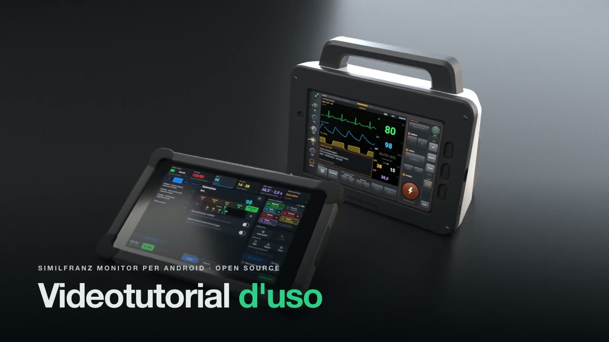
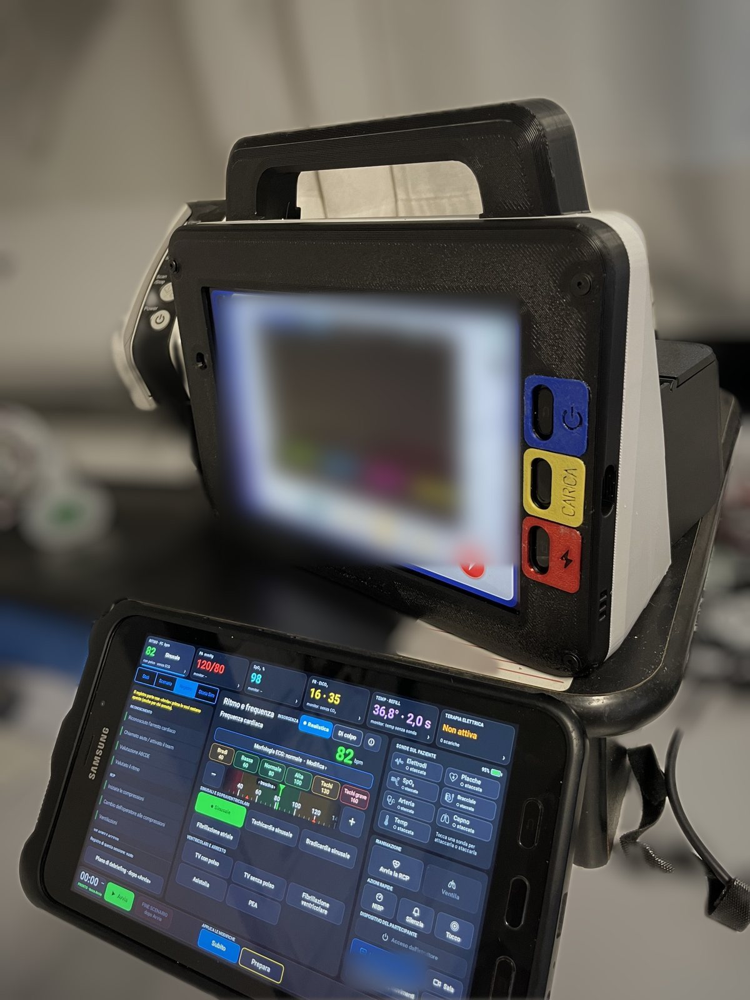

# similFranz Monitor per Android

[](https://doi.org/10.5281/zenodo.24563982)

Fa parte dell'**ecosistema similFranz**: tutti gli strumenti sulla [pagina similFranz](https://franz8787.github.io/similfranz/).

**Due tablet Android diventano un monitor-defibrillatore da simulazione e la sua cabina di regia.**
Pensato per un Samsung® Galaxy® Tab Active2, gira su tablet Android™ 8 o successivi. Open source, per formatori,
istruttori e facilitatori di simulazione sanitaria.

> **Solo per la simulazione sanitaria.** Non è un dispositivo medico: non misura, non eroga nulla e non va mai usato su
> persone o per decisioni cliniche.

Pagina del progetto: https://franz8787.github.io/similfranz-monitor-android/

## Avvio rapido

1. Dalla pagina [Releases](https://github.com/Franz8787/similfranz-monitor-android/releases) scarica i due APK:
   `similfranz-monitor-<versione>.apk` e `similfranz-controller-<versione>.apk`.
2. Installa il monitor sul primo tablet e il controller sul secondo; al primo avvio concedi i permessi richiesti.
3. Sul monitor apri il menu **☰ → Informazioni e collegamenti** e leggi il **PIN** (6 cifre).
4. Sul controller tocca il monitor nell'elenco e scrivi il PIN: il collegamento è diretto, basta il Wi-Fi® acceso su entrambi.
5. Tutti i dettagli (installazione dal computer, tasti del guscio, problemi): [docs/02-installazione.md](docs/02-installazione.md).

## Che cosa fa

### Il monitor (primo tablet)
- Tre layout originali: **ICU** (terapia intensiva), **extraH** (monitor-defibrillatore da emergenza territoriale),
  **DAE** (semiautomatico con voce guida), più la categoria **Personalizzati** per i tuoi frontali.
- ECG con ritmi di base e di arresto, SpO₂ e pletismografia, pressione non invasiva e invasiva, capnografia, frequenza
  respiratoria, temperatura, refill, allarmi con priorità; defibrillazione manuale e sincronizzata, pacing con soglia di
  cattura elettrica e meccanica. I valori compaiono solo se il sensore è collegato.
- Su extraH: **ECG a 12 derivazioni** con referto automatico e **trasmissione simulata alla Centrale Operativa**;
  l'istruttore risponde dalla regia («centralizzare» o «non centralizzare» il paziente) e la risposta compare sul monitor.
- **In mano è un defibrillatore, non un tablet.** I tasti fisici del tablet diventano **ACCENSIONE**, **CARICA** e
  **SCARICA**, su tutti i layout. A ogni scarica senti il «cia-clack» dei relè e una **vibrazione**; nel pacing, una vibrazione lieve a
  ogni impulso. Per uscire alla Home servono tre pressioni: nessuno esce per sbaglio dalla simulazione.
- **Modello fisiologico** che lega ritmo, circolo e respiro: l'EtCO₂ segue la RCP, la pletismografia la perfusione, il
  ROSC ha il suo picco. Semplificato e orientato alla plausibilità clinica dei segnali.

### Il controller (secondo tablet)
- Collegamento **diretto** al monitor (Wi-Fi Direct®), senza rete: lo trovi nell'elenco e scrivi il PIN.
- Tessere con i valori veri del paziente e, sotto, che cosa vede chi è al monitor; **Subito** o **Prepara** (più
  parametri insieme, con una durata); sonde collegate con un tocco.
- **Scenari a fasi** che avanzano solo quando lo decidi tu; stati del paziente pronti; RCP e ventilazione; **esito di
  ogni scarica deciso da te**.
- Registro con le tue osservazioni, piano di debriefing e **Storia Sim** con il verbale in PDF.
- **Volume del monitor a distanza.** Se in sala il monitor è troppo forte o troppo piano, lo regoli dal controller senza
  entrare nello scenario: volume dei suoni del simulatore e volume di sistema del tablet. Il controller **vibra a ogni
  scarica** e a ogni impulso di pacing erogati sul monitor.
- Più regie sullo stesso monitor: ne comanda una alla volta, le altre osservano e annotano.

### Monitor e controller insieme
Ogni tocco sul controller cambia il monitor in tempo reale, gradualmente o di colpo, come cambierebbe il paziente.
Guardalo nel [video](docs/img/insieme_video.mp4): dal primo collegamento al debriefing, con le due viste affiancate.

**Videotutorial (circa 8 minuti e mezzo).** Dieci capitoli con controller e monitor affiancati, dal primo collegamento
al debriefing e ai tasti fisici del tablet nel guscio, con le pause «prova tu»: **[guardalo sulla pagina del progetto](https://franz8787.github.io/similfranz-monitor-android/#videotutorial)**.

[](https://franz8787.github.io/similfranz-monitor-android/#videotutorial)

GitHub® non mostra in anteprima i video di queste dimensioni: il file è [docs/video/videotutorial.mp4](docs/video/videotutorial.mp4), da scaricare con «Download raw file».

### La sala in diretta (audio e video)
Fotocamera frontale e microfono del monitor arrivano **in diretta** sul controller e nella regia web del computer
(tasto **Sala**), a chi ha il comando: puoi condurre da un'altra stanza. Solo diretta, **nulla viene registrato**; finché è aperta il monitor mostra sempre «● IN DIRETTA».
Va usata con il consenso dei partecipanti (GDPR).

### La regia web
Dal browser di un computer sulla stessa rete del monitor: indirizzo e PIN, nessuna installazione. Schermo grande con
parametri, stati, scenari, defibrillatore, allarmi, figura del paziente per le sonde e registro.

### Il guscio
Stampabile in 3D, con maniglia incassata, schermo inclinato e borsa posteriore per le sonde: [stampa3d/](stampa3d/).
Già stampato e montato: le foto dei pezzi veri sono in [stampa3d/](stampa3d/#il-guscio-stampato). Come alternativa
alla borsa c'è una tasca a due vani per piastre e cavi, stampata e in prova d'uso:
[stampa3d/tasca_due_vani/](stampa3d/tasca_due_vani/).



## Da dove partire

| Voglio… | Leggi |
|---|---|
| installare le app sui tablet | [docs/02-installazione.md](docs/02-installazione.md) |
| vedere come si usa, in video | [videotutorial sulla pagina del progetto](https://franz8787.github.io/similfranz-monitor-android/#videotutorial) |
| usarlo in un corso | [docs/03-uso.md](docs/03-uso.md) |
| un esempio completo di scenario | [docs/04-caso-d-uso.md](docs/04-caso-d-uso.md) |
| usare i tasti fisici, bloccare lo schermo, regolare il volume dal guscio | [docs/monitor.md](docs/monitor.md#tasti-fisici-del-tablet-e-schermo) |
| dedicare il tablet solo alla simulazione (facoltativo) | [docs/ottimizzazione.md](docs/ottimizzazione.md) |
| conoscere ogni schermata del monitor | [docs/monitor.md](docs/monitor.md) |
| conoscere ogni tasto del controller | [docs/controller.md](docs/controller.md) |
| usare la regia web dal computer | [docs/regia-web.md](docs/regia-web.md) |
| creare un mio layout | [docs/layout-personalizzati.md](docs/layout-personalizzati.md) |
| stampare il guscio | [stampa3d/](stampa3d/) |
| sapere come è stato verificato | [revisioni/](revisioni/) e [stampa3d/](stampa3d/) |

Con **Claude Code™** puoi farti guidare nell'installazione: apri questa cartella e chiedi «installa similFranz sui miei
tablet» (istruzioni in [CLAUDE.md](CLAUDE.md)).

## Struttura

```
monitor/      app del monitor (Kotlin) e cuore del simulatore con i test (core-*)
controller/   app della regia
scripts/      compilare, installare, attivare i tasti del guscio, ottimizzare il tablet
docs/         guide e pagina del progetto
stampa3d/     guscio per il Galaxy Tab Active2 (STL e montaggio)
revisioni/    sintesi delle revisioni specialistiche simulate e delle correzioni
```

## Verifiche

- **Revisione degli esperti con Claude Code.** Con Claude Code ogni agente ha ricevuto il ruolo e il punto di vista di
  uno specialista: esperto di simulazione sanitaria, anestesista-rianimatore, medico dell'emergenza territoriale,
  cardiologo clinico, emodinamista, cardiochirurgo, elettrofisiologo, infermiere di terapia intensiva e di area critica.
  Ne sono uscite 44 correzioni cliniche, ognuna con il suo test: [revisioni/](revisioni/). Sono revisioni **simulate
  dall'intelligenza artificiale**, guidate e verificate dall'autore: non sono il parere di professionisti reali né una
  validazione clinica.
- **Software.** Oltre mille test automatici del cuore del simulatore (`cd monitor && ./gradlew :core-tests:run`), bug
  cercati e riprodotti con script, analisi dell'usabilità della regia.
- **Guscio.** Stabilità sulla pedana inclinabile, montabilità con gli inserti a caldo, controllo delle mesh:
  [stampa3d/verifiche/VERIFICHE.md](stampa3d/verifiche/VERIFICHE.md). Simulazioni al computer, non una certificazione.

## Come citarlo

Se similFranz ti è utile in un corso, un poster, una tesi o un articolo, usalo liberamente: è nato per questo.
Citarlo è il modo più semplice per far sapere ad altri formatori, istruttori e facilitatori di simulazione che esiste,
e per tenere unita la rete di chi lo usa. E se lo migliori, raccontacelo qui su GitHub: segnalazioni
([issue](https://github.com/Franz8787/similfranz-monitor-android/issues)), idee e modifiche sono benvenute, così il lavoro di uno diventa di tutti.

Se lo usi in un corso, un poster o un articolo, trovi la citazione pronta con il pulsante
**Cite this repository** qui su GitHub (file [`CITATION.cff`](CITATION.cff)). Ogni versione è archiviata
su [Zenodo](https://zenodo.org), l'archivio scientifico del CERN, con un DOI permanente:
[doi.org/10.5281/zenodo.24563982](https://doi.org/10.5281/zenodo.24563982) (punta sempre all'ultima versione).

> Palmisano, F. (2026). *similFranz Monitor per Android: simulatore di monitor-defibrillatore guidato dal facilitatore,
> su tablet riutilizzati, per la simulazione sanitaria*. Zenodo. https://doi.org/10.5281/zenodo.24563982

## Licenze, marchi e responsabilità

- Codice e documentazione: **GPL-3.0** ([LICENSE](LICENSE)). Modelli 3D: **CC BY-NC 4.0** ([stampa3d/LICENSE](stampa3d/LICENSE)).
  Materiale di terzi: [CREDITI.md](CREDITI.md). Eccezione: la figura del paziente della regia web (`body.svg`) è di terzi
  e resta sotto **CC BY-SA 4.0**, compatibile in un solo verso con la GPL-3.0 (si può includere in un'opera GPL-3.0
  mantenendo attribuzione e licenza della figura).
- Software fornito «così com'è», senza garanzie. Installazione, stampa 3D e montaggio sono sotto la responsabilità di chi
  li esegue.
- **Privacy**: se usi la Sala (videocamera e microfono) o scrivi nomi nella Storia Sim, informa i partecipanti e raccogli
  il loro consenso secondo il GDPR e le regole della tua struttura. Il progetto non invia dati a nessun server.
- I layout sono originali e non riproducono dispositivi in commercio. Progetto indipendente, non affiliato né approvato
  da Samsung, Google, Anthropic o da alcun produttore di monitor o defibrillatori. Samsung® e Galaxy® sono marchi
  registrati di Samsung Electronics Co., Ltd.; Android™ è un marchio di Google LLC; Wi-Fi® e Wi-Fi Direct® sono marchi
  registrati di Wi-Fi Alliance; Claude™ è un marchio di Anthropic, PBC; GitHub® è un marchio registrato di GitHub, Inc.; iPad® e iPod touch® sono
  marchi di Apple Inc.

## Ringraziamenti

Grazie a **FraPizz**, il collega che ha messo a disposizione i due tablet Android su cui questo progetto è nato e
cresciuto.

© 2026 Francesco Palmisano (ilFranz) · [ORCID 0009-0009-9368-0212](https://orcid.org/0009-0009-9368-0212).
Sviluppato con l'aiuto di Claude Code, sotto la guida e la verifica dell'autore.
Parte dell'ecosistema similFranz: [monitor per iPad®](https://github.com/Franz8787/similfranz-monitor) ·
[saturimetro su iPod touch®](https://github.com/Franz8787/similfranz-saturimetro).
