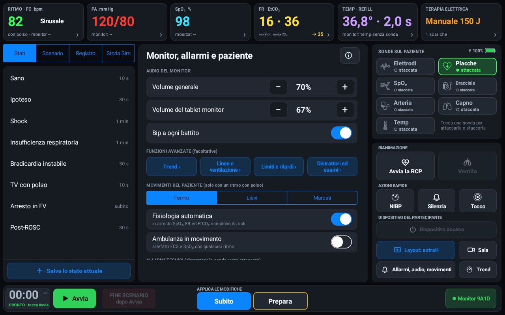

# Il controller: guida alla regia da tablet

> similFranz Controller è la regia di un simulatore per la **simulazione sanitaria**: non è un dispositivo medico e non
> va mai usato su persone.

Questa guida spiega ogni schermata e ogni tasto dell'app *similFranz Controller* (tablet Android™ 8 o successivo, per
esempio un secondo Samsung® Galaxy® Tab Active2). Per il giorno del corso, passo per passo, leggi la
[guida all'uso](03-uso.md).

## Indice

1. [Collegamento al monitor](#1-collegamento-al-monitor)
2. [La schermata](#2-la-schermata)
3. [Subito, Prepara e le durate](#3-subito-prepara-e-le-durate)
4. [Stati e scenari a fasi](#4-stati-e-scenari-a-fasi)
5. [Arresto: RCP, Ventila e qualità](#5-arresto-rcp-ventila-e-qualità)
6. [Esito delle scariche e pacing](#6-esito-delle-scariche-e-pacing)
7. [Allarmi, audio, movimenti](#7-allarmi-audio-movimenti)
8. [Regia DAE e malfunzionamenti](#8-regia-dae-e-malfunzionamenti)
9. [Registro](#9-registro)
10. [FINE SCENARIO e piano di debriefing](#10-fine-scenario-e-piano-di-debriefing)
11. [Storia Sim e PDF](#11-storia-sim-e-pdf)
12. [Sala](#12-sala)
13. [Più regie: «Prendi il comando»](#13-più-regie-prendi-il-comando)
14. [Se il collegamento cade](#14-se-il-collegamento-cade)
15. [Vedi anche](#vedi-anche)

## 1. Collegamento al monitor

1. Sul **monitor** apri *similFranz Monitor*. Sul **controller** apri *similFranz Controller*: la schermata dice
   «Cerco i monitor vicini…» e, se non compare nulla, ricorda di aprire l'app sull'altro tablet e di tenere i due
   tablet vicini.
2. Quando il monitor compare, «Scegli il monitor»: per ognuno vedi il **codice**, il nome, le tacche del segnale e se è
   **Libero** o «In uso da …· puoi annotare». In cima c'è l'**Ultimo usato**; il **più vicino** è segnalato.
3. Toccalo. Hai due strade:
   - **Senza PIN**: sul monitor compare «Associare questo monitor?»: tocca **Associa**. Sul controller leggi «Conferma sul
     monitor».
   - **Con il PIN**: tocca **Usa il PIN** e scrivi le 6 cifre che leggi sul monitor in **menu ☰ → Informazioni e collegamenti**. Parte da
     solo alla sesta cifra.
4. Il collegamento è **diretto, tablet con tablet** (Wi-Fi Direct®): non serve nessuna rete, basta il Wi-Fi® acceso su
   entrambi. Durante «Collegamento a …» puoi toccare **Annulla**.
5. **Ricollegamento**: il controller ricorda il monitor e le volte successive si ricollega da solo. Per cambiare monitor
   scegli «Scegli un altro monitor» (o «Scollega e scegli un altro monitor» dal menu del timer).
6. Puoi **rinominare** questo controller (nome che compare sul monitor, con un codice che non cambia).

## 2. La schermata

La regia è un'unica schermata; ogni parte aggiorna i valori **veri** del paziente.

### Tessere in alto

Sei tessere: **Ritmo e FC**, **pressione** (PAs/PAd), **SpO₂**, **FR · EtCO₂**, **TEMP · REFILL** e **TERAPIA
ELETTRICA**. Sotto ogni valore leggi che cosa vede chi sta al monitor, per esempio «senza ECG» o «monitor: senza CO₂».
Se il valore esce dai limiti compare «FUORI LIMITI». **Tocca una tessera** per regolarla nel pannello centrale.

### Colonna sinistra

**Stati**, **Scenario**, **Registro**, **Storia Sim**, più il tempo e i comandi del timer (vedi sotto).

### Pannello centrale

Il parametro scelto, con i valori rapidi, il righello con zone (Bradicardia, Normale, Tachicardia…) da trascinare e i
tasti − e +. Per il ritmo trovi i gruppi **Sinusali e sopraventricolari** (Sinusale, Tachicardia sinusale, Bradicardia
sinusale, Fibrillazione atriale, TV con polso) e **Ventricolari e arresto** (Fibrillazione ventricolare, TV senza
polso, Asistolia, PEA). **Insorgenza**: *Realistica* (con preludio fisiologico) o *Di colpo*; **Subito ora** salta il
preludio. Per la FV scegli l'ampiezza (*Grossolana*, *Fine*, *Automatica*): sotto 0,1 mV il DAE non consiglia la scarica.
**Morfologia ECG** apre l'elenco delle alterazioni (ST, blocchi di branca, blocchi AV, scappamento, altre).

### Colonna destra

| Riquadro | Contenuto |
|---|---|
| **SONDE SUL PAZIENTE** | **Elettrodi**, **Placche**, **SpO₂**, **Bracciale**, **Arteria**, **Capno**, **Temp**. «Tocca una sonda per attaccarla o staccarla»; ogni tessera dice «● attaccata» o «○ staccata». Per staccare tocca di nuovo entro 3 secondi. Un monitor mostra solo ciò che è collegato. |
| **RIANIMAZIONE** | **Avvia la RCP** (poi «● RCP IN CORSO»), **Ventila**. |
| **AZIONI RAPIDE** | **NIBP** (fa partire la misura), **Silenzia** (silenzia gli allarmi), **Tocco** (un operatore tocca il paziente per 3 secondi: artefatto). |
| **DISPOSITIVO DEL PARTECIPANTE** | **Accendi il dispositivo**: lo accendi al posto dei partecipanti. |
| **Layout del monitor** | Elenco dei layout (ICU, extraH, DAE e i Personalizzati) con la miniatura; il layout in uso ha «● In uso». |
| **Sala** | Immagine e audio dal monitor, in diretta (vedi §12). |
| **Allarmi, audio, movimenti** | Vedi §7. |

### Barra in basso

- Il **tempo dello scenario**, con **Avvia** (poi **Pausa** e **Riprendi**). Prima di «Avvia» non si registra niente e il
  piano di debriefing non si apre. Toccando il tempo si apre il menu del timer: **Azzera il timer**, **Azzera lo scenario
  e spegni il monitor…** (con conferma), «Scegli un altro monitor».
- **FINE SCENARIO** (con conferma).
- **APPLICA LE MODIFICHE**: **Subito** o **Prepara** (§3).

## 3. Subito, Prepara e le durate

| Modo | Che cosa succede |
|---|---|
| **Subito** | Ogni modifica parte appena tocchi. I valori arrivano al nuovo valore con una transizione graduale di **20 secondi**; i ritmi di arresto partono di colpo. |
| **Prepara** | Cambi più parametri senza che partano: li vedi «IN ATTESA». Scegli una **DURATA** (10 s, 30 s, 1 min, 2 min) e tocca **Applica (N)**: partono insieme e arrivano insieme. È il modo per un deterioramento progressivo. I ritmi di arresto partono comunque subito. |

Con modifiche in attesa:

- **Scarta (N)** le butta (serve una seconda pressione di conferma); **Ripristina (N)** le recupera per 5 secondi.
- Se passi da Prepara a Subito con modifiche in attesa il controller chiede che cosa farne: *Resta in «Prepara»*,
  *Applica ora*, *Scarta le modifiche*.
- Per il refill e la temperatura il valore arriva senza transizione (in Prepara quando premi Applica).

## 4. Stati e scenari a fasi

### Stati

**Stati** applica un intero quadro clinico con un tocco. Di serie: *Sano*, *Ipoteso*, *Shock*, *Insufficienza
respiratoria*, *Bradicardia instabile*, *TV con polso*, *Arresto in FV*, *Post-ROSC*. **Salva lo stato attuale** fotografa i
valori veri di adesso in uno stato nuovo, che puoi dare un nome e rieliminare.

### Scenari a fasi

Nella scheda **Scenario**:

- **Nuovo scenario** apre il costruttore. **Modifica** riapre uno scenario salvato.
- Nel costruttore dai un **nome** e, se vuoi, una descrizione (paziente, contesto, obiettivi). Le **FASI** (fino a un
  massimo) si ordinano con **Giù**, **Duplica**, **Elimina**. Per ogni fase: nome, **tempo di transizione** (quanto ci
  mette ad arrivare ai valori: *Subito*, 1 min, 2 min, 5 min), **ritmo** (o «Non cambia»), **morfologia ECG** (*ECG
  normale* o *Con alterazioni…*), i **parametri** (acceso = cambia in questa fase, spento = resta com'è) e la **nota per
  l'istruttore** (quando passare alla fase successiva).
- **fase dai valori attuali** crea una fase con i valori che il paziente ha adesso. **Salva sul monitor** salva lo
  scenario (gli scenari stanno sul monitor); **Elimina scenario** lo cancella.
- Il controller ti avvisa se manca il nome, se non c'è nessuna fase, se una fase è vuota o se la diastolica non è più
  bassa della sistolica.

### Condurre lo scenario

1. Apri lo scenario e tocca **Avvia lo scenario**: parte il timer e il registro.
2. Resti nella fase finché **non decidi tu** di passare alla successiva: tocca «Fase successiva» (o **Vai a questa
   fase** su una fase a scelta, **Riapplica questa fase** per rifarla). La nota per l'istruttore te lo ricorda; lo
   scenario non avanza mai da solo.
3. **Termina lo scenario** (secondo tocco di conferma) lo ferma.

## 5. Arresto: RCP, Ventila e qualità

- Scegli il ritmo di arresto: parte subito e la tessera diventa rossa «senza polso».
- Quando iniziano le compressioni tocca **Avvia la RCP**. Si apre il pannello **«Come vedi l'RCP?»**: di base la qualità
  è corretta; cambia solo ciò che vedi fare male.
  - **Frequenza**: **Lenta**, **Corretta**, **Veloce**, oppure **Batti il tempo** (tocca a ogni compressione che vedi).
  - **Profondità**: **Superficiale**, **Corretta**, **Troppo profonda**.
  - **Rilascio del torace**: **Completo** / **Incompleto**. **Posizione delle mani**: **Corrette** / **Scorrette**.
  - **Stanchezza di chi comprime**: **Cambio operatore** la azzera (cambio consigliato ogni 2 minuti).
  - **Interrompi RCP** (poi **Riprendi la RCP**); **Torna al modello** riporta l'EtCO₂ al modello della qualità.
- **Ventila**: tocca a ogni insufflazione. Solo allora compaiono capnogramma ed EtCO₂ (come nella realtà). In
  **Ventilazioni in arresto (EtCO₂)** scegli *Automatiche* (il monitor ventila da solo: 30:2 con la maschera, 10/min con via
  aerea avanzata), *A mano* (solo quando premi) o *Sempre visibile*.
- Con un ritmo che ha polso le compressioni non cambiano pressione ed EtCO₂.

## 6. Esito delle scariche e pacing

Le scariche le erogano i **partecipanti** sul monitor; tu decidi che cosa succede. Si trova nella tessera **Terapia
elettrica** (modo del dispositivo: *Monitoraggio*, *DAE*, *Manuale*, *Pacer*) e nei pannelli sotto.

### Esito di ogni scarica

- **Decido io dopo ogni scarica** (consigliato): dopo ogni scarica il controller chiede «Scarica erogata: che cosa succede
  adesso?» (o «Cardioversione erogata…» se era sincronizzata) con le risposte *Resta in …*, *Sinusale (ROSC)*,
  *Tachicardia sinusale (ROSC)*, *Fibrillazione ventricolare*, *Altro ritmo…*. Hai 5 secondi per **Annulla** un avanzamento
  automatico.
- **Regole automatiche**: **Scariche per convertire** (0 = mai), **Energia minima efficace** (sotto, la scarica non conta) e
  **Ritmo dopo la scarica efficace**.
- **Esito di ogni scarica (sequenza)**: prepari in anticipo, per esempio «la prima no, la seconda converte». **+ scarica**
  aggiunge un passo, **− ultima** lo toglie, **Togli la sequenza** annulla. Ogni passo è *Resta nel ritmo*, *Converte* o
  *Passa a: …*. La sequenza sostituisce «Scariche per convertire» per FV e TV senza polso.

### Cardioversione e pacing

- **Scarica non sincronizzata → FV**: su un ritmo con polso (R su T) l'errore ha una conseguenza.
- **La SYNC si spegne dopo la scarica**; **Ritmo dopo la cardioversione efficace**.
- **Pacing**: **Soglia di cattura** (sotto, il pacing non cattura), **La cattura è possibile**, **La cattura genera polso e
  pressione** (spento: solo cattura elettrica), **Falsa cattura** (spike senza cattura).
- **Contatto delle placche** (*Buono*, *Non ottimale*, *Scarso*) si regola da «Distrattori ed esami» (§7) e finisce nel
  registro.

## 7. Allarmi, audio, movimenti

**Allarmi, audio, movimenti** (colonna destra) raccoglie:

- **Audio del monitor**, in cima: **Volume generale** dei suoni del simulatore, **Volume del tablet monitor** (il volume
  di sistema del tablet), **Bip a ogni battito**. Servono a regolare il monitor **a distanza**: se ti accorgi a scenario
  avviato che è troppo forte o troppo piano, non devi entrare in sala. Il volume del tablet resta allineato con quello
  del menu ☰ del monitor.

  

- **Movimenti del paziente** (solo con un ritmo con polso): *Fermo*, *Lievi*, *Marcati*.
- **Fisiologia automatica**: in arresto SpO₂, FR ed EtCO₂ scendono da soli.
- **Allarmi tecnici** (la sonda resta attaccata): *Elettrodi ECG scollegati*, *Sonda SpO₂ scollegata*, *Errore del
  bracciale NIBP*, *Linea CO₂ occlusa*, *Batteria scarica*.
- **Questo controller**: **Vibrazione ai comandi**. Con la vibrazione attiva il controller vibra anche a ogni scarica
  e, più lieve, a ogni impulso di pacing erogati sul monitor.
- **NIBP automatica** (minuti fra le misure).
- **Limiti di allarme**: FC alta/bassa, SpO₂ bassa, sistolica alta/bassa, FR alta/bassa, EtCO₂ alta/bassa;
  **Ripristina i limiti predefiniti**.
- **Funzioni avanzate (facoltative)**, di serie spente: **Trend**, **Linee e ventilazione**, **Allarmi**, **Distrattori ed esami**.
  - *Trend*: tabella e grafico dei valori, con passo 1, 5 o 15 min (si aggiorna da solo dopo «Avvia»).
  - *Linee e ventilazione*: linea arteriosa (smorzamento, livello del trasduttore, linea occlusa, zero obbligatorio,
    **Zero**, lavaggio rapido), **PVC**, **temperatura centrale (T2)**, ventilazione (*Respiro spontaneo*, *Ventilatore*,
    *Pallone*, frequenza, volume corrente, PPV).
  - *Allarmi*: limiti separati ART/NIBP (sistolica e PAM), SpO₂ alta, temperatura; ritardi d'allarme; **Silenzia gli
    allarmi 2 min**; profili rapidi (*Di serie*, *ICU shock*, *Post-ROSC*).
  - *Distrattori ed esami*: un elettrodo staccato, tracciato disturbato, cavi delle braccia invertiti, NIBP con tempo di
    misura superato, **Contatto delle piastre**, **I partecipanti risolvono i tecnici col gesto** (tocco lungo), ed
    **Esami e bilancio** (PaO₂, PaCO₂, lattati, glicemia, diuresi, bilancio…): vanno nel registro, non sul monitor.

## 8. Regia DAE e malfunzionamenti

Se sul monitor c'è il layout DAE puoi aprire la **regia DAE** («Apri la regia DAE»; per tornare indietro **Regia
completa**). Qui:

- **Accendi il DAE**.
- **Problemi durante l'uso**: **Tocco del paziente · 3 s**, **Movimento · 10 s**, **Ambulanza in movimento**, **Placche con
  contatto scarso**, **Placche collegate**, **Cavo delle placche collegato**.
- **Paziente pediatrico**: *Placche per adulti* / *Placche pediatriche*, **Modalità bambino del DAE**, **Energia pediatrica**.
- **Quando la scarica converte**: **Decido io dopo ogni scarica** o **Regole automatiche**.
- **Ciclo del DAE**: **RCP fra le analisi**, **Istruzioni vocali**.
- **Qualità della RCP**: frequenza e profondità, come in §5.
- **Malfunzionamenti del dispositivo** (anche a dispositivo spento): batteria, placche, dispositivo e ambiente,
  avanzati; **Dispositivo a posto** li risolve tutti. Servono per simulare, per esempio, una batteria da sostituire o
  placche scadute; il partecipante vede la spia e la finestrella di stato giusta.

## 9. Registro

Il registro **parte con «Avvia»**; prima le voci restano spente (anche per chi annota).

- **Da solo** annota quello che fanno i partecipanti: sonde applicate, misure NIBP, cariche, scariche con l'energia,
  pacing, allarmi con i tempi di risposta, fasi dello scenario.
- **Tu** aggiungi le osservazioni con un tocco, in gruppi:

| Gruppo | Voci |
|---|---|
| **Riconoscimento** | Riconosciuto l'arresto cardiaco · Chiamato aiuto / attivato il team · Valutazione ABCDE · Valutato il ritmo |
| **RCP** | Iniziate le compressioni · Cambio dell'operatore alle compressioni · Ventilazioni |
| **Vie aeree e accessi** | Ossigeno · Presidio sovraglottico · Intubazione · Accesso venoso · Accesso intraosseo |
| **Farmaci** | Adrenalina 1 mg · Amiodarone 300 mg · Amiodarone 150 mg · Atropina 0,5 mg · Liquidi 500 ml · **Altro farmaco…** |
| **Per il debriefing** | **Punto di forza…** · **Da discutere…** · **Nota libera…** |

Le voci con «…» chiedono due parole (per esempio «Che cosa è andato bene»), poi **Registra**. Ogni voce porta il tempo di
scenario. Se il collegamento è giù la voce resta in coda col suo tempo.

### Rispondere come Centrale Operativa

Quando i partecipanti trasmettono l'ECG a 12 derivazioni da extraH, in alto compare l'avviso **«ECG 12D trasmesso alla
Centrale Operativa per valutazione»** con ora, frequenza e referto. Tocca **«Rispondi come centrale»** e scegli:

- **Centralizzare il paziente**
- **Non centralizzare il paziente**
- **Testo libero…**, se vuoi aggiungere un'indicazione.

La risposta compare sul monitor dei partecipanti e finisce nel registro con il tuo nome e il tempo di scenario. Lo
scenario deve essere avviato.

## 10. FINE SCENARIO e piano di debriefing

**FINE SCENARIO** chiede conferma («Fine scenario?»): sul monitor compare «Scenario terminato» e la simulazione va in
pausa; sul controller si apre il **Piano di debriefing**. Le modifiche in attesa non vengono applicate.

Il piano mostra:

- **Durata**, **arresto cardiaco** con i tempi: riconoscimento, prime compressioni, prima scarica, ROSC; frazione di
  compressione; **scariche erogate** (con energia e se erano sincronizzate), **farmaci**, **segnati dall'istruttore**
  (punti di forza e da discutere), **allarmi**.
- La cronologia, con i filtri **Punti chiave**, **Partecipanti**, **Terapia elettrica**, **Farmaci**, **Istruttore**,
  **Debriefing**, **Allarmi**, **Trend**, **Tutto**.
- **Titolo della simulazione** (proposto in automatico: toccalo per cambiarlo) e data e ora.
- **Squadra ed esito**: **Aggiungi un partecipante** con nome, **ruolo** (Medico, Infermiere, OTAS, «Altro ruolo» o
  «Nessun ruolo») e, per ciascuno, **Obiettivi raggiunti** e **Da rinforzare**.
- **Sessioni registrate**: una per simulazione; scegli «In corso» o una precedente; **Svuota il registro** o «Chiudi questa
  sessione e aprine una nuova».

Titolo e squadra restano sul tablet come bozza finché non li salvi o li scarti. Con **Chiudi** compare «Chiudere il piano
di debriefing?» con **Salva in Storia Sim**, **Non salvare** o **Resta nel debriefing**. In entrambi i primi due casi lo
scenario si azzera da solo: parametri, sonde, contatori e orologio tornano all'inizio e il monitor si spegne.

Il piano funziona anche **lontano dal monitor**: se non è raggiungibile, la simulazione si salva sul tablet e il monitor
si azzera da solo quando torni nella sala.

> **Privacy.** Nomi e ruoli di chi partecipa sono dati personali: trattali, conservali e condividili secondo il GDPR e le
> regole della tua struttura.

## 11. Storia Sim e PDF

**Storia Sim** (colonna sinistra) elenca le simulazioni salvate, con titolo, durata e numero di partecipanti; ognuna dice
se è «inviata al monitor» o «solo su questo tablet: da inviare al monitor» (parte da sola appena il monitor risponde).
Apri una simulazione per rivederla, **Apri il PDF** o eliminarla (secondo tocco di conferma).

Ogni simulazione salvata è anche un **PDF** nella cartella **Documenti › Storia Sim** del tablet. L'app *Storia Sim*
(con **Metti sulla schermata Home** per aggiungere l'icona) lo mostra, con **Apri** e **Condividi**.

## 12. Sala

**Sala** mostra l'immagine della **fotocamera frontale** e l'audio del **microfono** del monitor, in diretta, per chi
conduce da un'altra stanza.

- Tocca **Sala**: «Sala in diretta». **Audio spento** all'inizio: tocca **Audio** per ascoltare e regola il **Volume**.
  **Qualità: normale / bassa** riduce il flusso se la rete è debole; **Riprova** se il video non parte; **Chiudi la sala**.
- Arriva **solo a chi ha il comando**. Con un'altra regia al comando la Sala non è disponibile.
- È **solo una diretta**: nulla viene registrato né salvato. Sul monitor compare sempre **«● IN DIRETTA»**.
- Se il collegamento cade, la Sala si chiude da sola.

> **Privacy.** Prima di usare la Sala informa i partecipanti e raccogli il loro consenso, secondo il GDPR e le regole
> della tua struttura. Dillo anche nella familiarizzazione.

## 13. Più regie: «Prendi il comando»

Puoi collegare più regie allo stesso monitor (un secondo controller, la [regia web](regia-web.md)). **Comanda una regia
alla volta**.

- Chi non comanda **osserva e annota**: vede i valori veri, ma i comandi non partono. In basso compare la fascia arancione
  «Comanda …: da qui osservi e annoti nel registro» con **Prendi il comando** (un secondo tocco conferma).
- Chi perde il comando lo vede subito («… ha preso il comando») e può **Riprendere il comando**. Ogni passaggio resta nel
  registro.
- Piano di debriefing, Storia Sim e Sala (se hai il comando) restano a disposizione anche in osservazione.

## 14. Se il collegamento cade

- Il controller mostra una fascia gialla **«Ricollegamento a … N s»** e **mette in coda i comandi**: partono appena il
  monitor risponde. I valori sono quelli dell'ultima lettura; **Pausa, timer e FINE SCENARIO** restano a disposizione.
- Se qualcosa non arriva lo dice: **«NON ARRIVATI al monitor …»**: rifalli se servono ancora.
- Se il ricollegamento non riesce in un minuto torna la scelta del monitor.
- Il **monitor continua lo scenario da solo**. Il debriefing e Storia Sim funzionano lo stesso.

## Vedi anche

- [Guida all'uso](03-uso.md): il giorno del corso.
- [Il monitor](monitor.md): che cosa vedono e toccano i partecipanti.
- [Regia web](regia-web.md): la stessa regia dal computer.
- [Caso d'uso](04-caso-d-uso.md): uno scenario completo.

---
© 2026 Francesco Palmisano · GPL-3.0. Samsung® e Galaxy® sono marchi registrati di Samsung Electronics Co., Ltd.;
Android™ è un marchio di Google LLC; Wi-Fi® e Wi-Fi Direct® sono marchi registrati di Wi-Fi Alliance. Progetto
indipendente, non affiliato ai titolari dei marchi.
