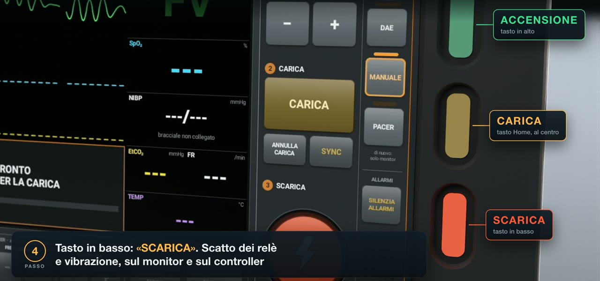
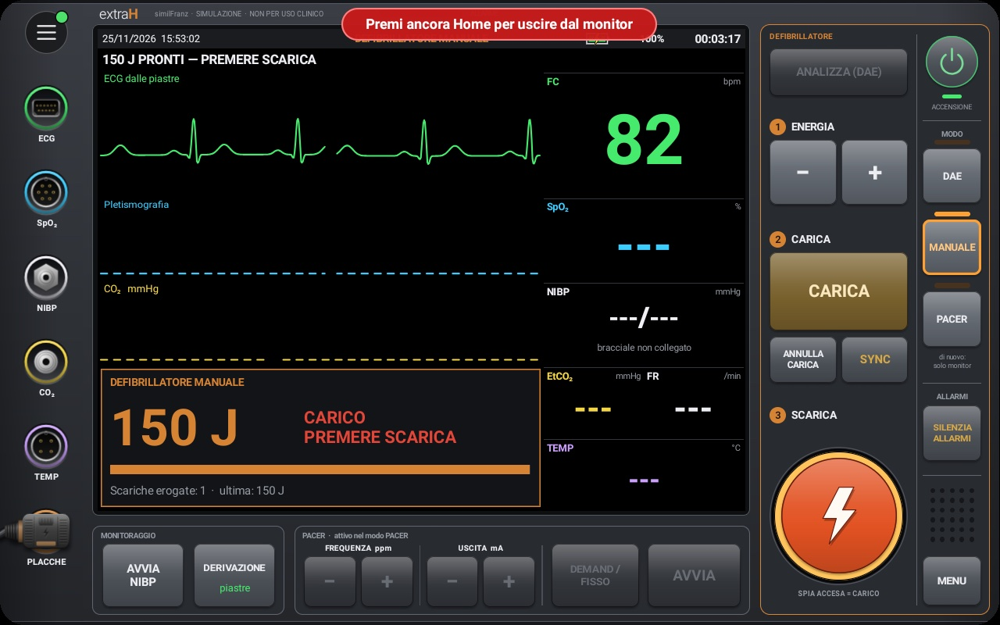
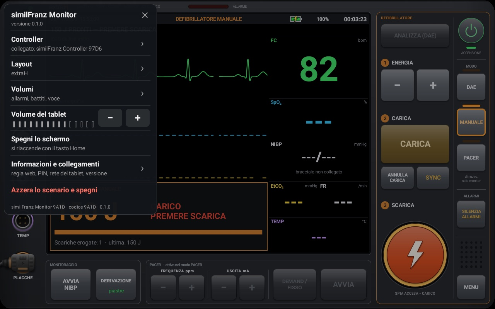

# Il monitor: guida allo schermo

> similFranz Monitor è un simulatore per la **simulazione sanitaria**: non è un dispositivo medico, non misura e non
> eroga nulla, e non va mai usato su persone.

Questa guida descrive **che cosa vedono e che cosa toccano i partecipanti** sul tablet Samsung® Galaxy® Tab Active2 con
Android™. Per condurre lo scenario leggi la guida del [controller](controller.md) o della [regia web](regia-web.md); per
il giorno del corso, la [guida all'uso](03-uso.md).

## Indice

1. [Che cos'è il monitor](#1-che-cosè-il-monitor)
2. [Il menu ☰](#2-il-menu-)
3. [Layout ICU](#3-layout-icu)
4. [Layout extraH](#4-layout-extrah)
5. [Layout DAE](#5-layout-dae)
6. [Personalizzati](#6-personalizzati)
7. [Avviso «● IN DIRETTA»](#7-avviso--in-diretta)
8. [Pausa e fine scenario](#8-pausa-e-fine-scenario)
9. [Senza regia collegata](#9-senza-regia-collegata)
10. [Vedi anche](#vedi-anche)

## 1. Che cos'è il monitor

È lo schermo che i partecipanti hanno davanti: un monitor-defibrillatore finto. Mostra quello che decidi tu dalla regia
(ritmo, frequenza, pressione, saturazione, respiro, temperatura) e **solo ciò che è stato collegato al paziente**, come
nella pratica clinica.

- I partecipanti **toccano il tablet** come toccherebbero un dispositivo vero: lo accendono, collegano le sonde, avviano
  la misura della pressione, silenziano gli allarmi, caricano e scaricano.
- Non c'è nessuna misura reale: bracciale, elettrodi e sensore sono oggetti di scena.
- Il paziente è lo stesso in tutti i layout: cambiando layout ritmo e parametri restano quelli.

## 2. Il menu ☰

Il tasto **☰** è in alto a sinistra, nello stesso punto in tutti i layout. È il menu dell'istruttore: i partecipanti non
ne hanno bisogno. In cima leggi **similFranz Monitor** e la **versione**; in fondo il nome del monitor, il codice e la
versione.

| Voce | Che cosa fa |
|---|---|
| **Controller** | Mostra se c'è un controller collegato. «Rinomina, PIN e reti…» apre il pannello completo; il **PIN** (6 cifre), il nome e il codice del monitor si leggono in **Informazioni e collegamenti**. |
| **Layout** | Sceglie il dispositivo da mostrare: categorie **Default** e **Personalizzati**. Il layout in uso ha la spunta ✓. |
| **Volumi** | Apre i volumi (allarmi, battiti, voce), relativi al volume generale del tablet e salvati. |
| **Volume del tablet** | Tasti **−** e **+** per il volume di sistema del tablet, senza usare i tasti fisici (nel guscio restano dietro lo sportellino). Si regola anche dal controller e le due indicazioni restano allineate. |
| **Spegni lo schermo** | Compare se hai attivato «Blocca schermo» (vedi sotto): spegne lo schermo; si riaccende con il tasto Home. |
| **Informazioni e collegamenti** | Apre il pannello «Collegamento del controller»: indirizzo della regia web, rete Wi-Fi®, PIN, nome del monitor, stato del collegamento diretto. |
| **Azzera lo scenario e spegni** | Chiede conferma («Azzerare lo scenario?»): il paziente torna alle condizioni iniziali, le sonde si staccano, contatori e registro si azzerano e il monitor si spegne. |

### Pannello «Collegamento del controller»

Si apre da **Informazioni e collegamenti** (o da «Rinomina, PIN e reti…»).

1. **Regia web, dal computer**: la rete a cui è collegato il tablet e l'indirizzo da scrivere nel browser del computer
   (poi il PIN). Il computer deve essere sulla stessa rete Wi-Fi. La regia web si usa solo dal computer.
2. **App regia, diretto**: il nome con cui il monitor compare nell'elenco del controller e il suo codice. **Rinomina**
   cambia il nome (il codice resta lo stesso e distingue due monitor con lo stesso nome). Sotto, lo **stato**: «Pronto: in
   attesa dell'app controller» oppure «Collegato: …». Non serve nessuna rete: il collegamento è Wi-Fi Direct®.
3. **PIN**: è lo stesso per la regia web e per l'app controller. Comanda un solo controller alla volta.

I tasti in basso sono **Reti Wi-Fi…** (scegli la rete del tablet, **Aggiorna elenco**, **Impostaz. tablet**),
**Volumi…** e **Chiudi**. In fondo a ogni pannello leggi «SIMULAZIONE — NON PER USO CLINICO».

Quando un controller si collega o si scollega compare per 3 secondi un avviso in alto («Controller collegato: …» o
«Controller scollegato: …»). Se un controller sceglie questo monitor con «Chiedi sul monitor», compare la richiesta
**«Associare questo monitor?»** con **Associa** e **Rifiuta**: toccando **Associa** il controller comanda, senza PIN.

### Tasti fisici del tablet e schermo

Con il tablet nel guscio il tasto di accensione e quelli del volume restano dietro lo sportellino. Il monitor si usa lo
stesso, senza aprirlo, e in mano si comporta come un defibrillatore: i tre tasti fisici sotto lo schermo diventano i
suoi tasti. Nel guscio, dall'alto in basso: accensione, carica, scarica.

| Tasto fisico | Con il monitor a schermo |
|---|---|
| **Home** | **CARICA**, con una pressione. Per uscire alla schermata Home servono **tre pressioni di fila**: così nessuno esce per sbaglio dalla simulazione. Alla seconda pressione un avviso rosso lo ricorda. |
| **App recenti** | **SCARICA**, come il tasto a schermo, in tutti i layout. In sincronizzata va tenuto premuto fino all'onda R. |
| **Indietro** | **ACCENSIONE**: accende e spegne il dispositivo simulato, con una pressione. Con **tre pressioni di fila** apre le app recenti. |

Il tasto fisico «preme» quello a schermo: lo vedi animarsi come sotto il dito. Accensione e carica partono dopo un
attimo (circa mezzo secondo), il tempo di capire se stai facendo le tre pressioni. Carica e scarica seguono le
stesse regole dei tasti a schermo: a dispositivo spento non fanno nulla, e senza piastre o
senza cavo la carica viene rifiutata con il suono di errore. Fuori dal monitor i tre tasti tornano quelli di Android.

- **Si sente e si sente in mano.** A ogni scarica il monitor fa il «cia-clack» dei relè e una vibrazione decisa; durante
  il pacing dà una vibrazione lieve e breve a ogni impulso erogato. Le stesse vibrazioni arrivano sul controller: chi
  conduce se ne accorge senza guardare lo schermo. Serve un tablet con il motore di vibrazione.
- **Icona «Blocca schermo».** Accanto all'icona del monitor trovi **Blocca schermo**: spegne lo schermo con un tocco
  (c'è anche nel menu ☰, **Spegni lo schermo**). Si riaccende con il tasto Home.
- **Volume del tablet.** Si regola dal menu ☰ e, a distanza, dal controller.

| L'avviso alla seconda pressione di Home | Il menu ☰ con volume e «Spegni lo schermo» |
|---|---|
|  |  |

**Come si attiva.** Dal computer, con il tablet collegato: `scripts/tasti-guscio.sh attiva`. A mano:

1. tasti fisici: **Impostazioni › Accessibilità › Servizi installati › «similFranz: tasti del monitor»**;
2. blocco dello schermo: tocca l'icona **Blocca schermo** e conferma la richiesta di Android.

Sono due permessi di Android. Il servizio dei tasti guarda soltanto i tre tasti fisici e solo mentre il monitor è a
schermo: non legge lo schermo e non raccoglie dati. «Blocca schermo» è un amministratore del dispositivo con la sola
facoltà di bloccare lo schermo. Senza il servizio dei tasti resta comunque la scarica dal tasto **Indietro**, senza le altre funzioni. Se i tasti smettono di
rispondere, controlla che il servizio sia ancora attivo: Android lo disattiva quando l'app viene arrestata dalle
Impostazioni («Arresto forzato»). Per
toglierli: `scripts/tasti-guscio.sh disattiva`, oppure dalle stesse voci delle Impostazioni (per disinstallare l'app
va prima disattivato «Blocca schermo» in **Impostazioni › Sicurezza › Amministratori dispositivo**).

## 3. Layout ICU

Monitor da terapia intensiva con defibrillatore a scomparsa. Lo usi per reparto, terapia intensiva, sala operatoria.

### Accensione

- All'avvio, schermo nero con **Standby** e «tocca per iniziare il monitoraggio»: un tocco accende il monitor.
- Il controller può accendere il dispositivo al posto dei partecipanti («Accendi il dispositivo»).

### Barra in alto

Da sinistra: **☰** · **ICU** · campo degli **allarmi clinici** · campo degli **allarmi tecnici** · **SILENZIA** ·
**DEFIB ▲** · orologio.

### Sonde

Le sonde si attaccano **toccando il tracciato** o la colonna dei valori: ECG (elettrodi), SpO₂ (sonda), ART (linea
arteriosa), CO₂ (capnografo), NIBP (bracciale), temperatura. Un tocco **collega**, non scollega mai: per staccare una
sonda serve la regia. Finché una sonda non è collegata il tracciato mostra la scritta del caso, per esempio
**ELETTRODI NON COLLEGATI**, **SONDA SpO2 NON COLLEGATA**, **SENSORE CO2 NON COLLEGATO**, **TRASDUTTORE ART NON COLLEGATO**,
**Bracciale non collegato**.

Con un **tocco lungo** sul tracciato o sulla presa i partecipanti risolvono gli allarmi tecnici simulati («controllo e
sistemo»); il registro scrive quanto ci hanno messo. Se la regia ha attivato un disturbo, i valori mostrano «---» finché
non viene risolto.

### NIBP (pressione non invasiva)

- Il tasto **AVVIA NIBP** fa partire la misura: vedi «Gonfiaggio», poi «Sgonfiaggio», poi il valore.
- Toccando il valore della pressione si apre il suo pannello, dove trovi anche **Misura automatica ogni (minuti)** e
  **Avvia misura adesso**.
- Con la misura automatica attiva leggi «AUTO ogni N min» e quando sarà la prossima.

### Allarmi e silenzio

- Gli allarmi suonano con la loro priorità: i clinici in alto, i tecnici nel campo vicino.
- **SILENZIA 20 s** li silenzia; durante il silenzio il tasto dice «SILENZIATO N s». Tocca di nuovo per riattivarli.
- Toccando un valore (FC, SpO₂, ART, EtCO₂, FR, NIBP, temperatura) si apre il pannello **«… — allarmi»** con
  l'interruttore **Allarme**, i limiti **alto** e **basso** e, dove serve, i tasti **Zero (all'aria)**, **Collega PVC** /
  **Scollega PVC** e **Collega T2 (centrale)** / **Scollega T2**. **Chiudi** esce.
- **TREND** (in basso) apre la finestra dei trend; ritoccandolo si chiude.

### Defibrillatore (cassetto)

**DEFIB ▲** apre il cassetto «DEFIBRILLATORE» (si chiude con **▼ CHIUDI**). In alto scegli il modo:

| Modo | Che cosa si tocca |
|---|---|
| **SPENTO** | Il cassetto resta chiuso al lavoro. |
| **DAE** | Semiautomatico con istruzioni vocali: **ANALIZZA**, poi **SHOCK** quando è consigliato; dopo la scarica parte la RCP di 2 minuti. |
| **MANUALE** | **ENERGIA −/+**, **CARICA** (con barra di avanzamento), **SHOCK**, **ANNULLA CARICA** per disarmare, **SYNC** per la scarica sincronizzata. |
| **PACER** | **FREQUENZA ppm** e **CORRENTE mA** con −/+, **DEMAND** / **FISSO**, **AVVIA PACING** / **FERMA PACING**. |

Altre cose da sapere:

- Il tasto delle piastre dice **APPLICA LE PIASTRE** finché non sono collegate, poi **PIASTRE COLLEGATE ✓** (o
  **PIASTRE PEDIATRICHE ✓**). Senza piastre, la traccia mostra «PIASTRE NON APPLICATE» o «CAVO DELLE PIASTRE SCOLLEGATO».
- **SYNC**: lo shock parte sulla prossima onda R. Senza QRS riconoscibili (FV) la scarica sincronizzata non viene erogata.
- Nel pacer aumenta i mA fino alla cattura elettrica (QRS largo e onda T dopo ogni spike), poi verifica il polso:
  la cattura meccanica.
- Il **contatto scarso** delle piastre, l'**impedenza alta** e gli altri guasti decisi dalla regia compaiono come messaggi
  tecnici (per esempio «CONTROLLARE LE PIASTRE», «SCARICA NON EROGATA»).

## 4. Layout extraH

Monitor-defibrillatore da emergenza territoriale: ambulanza, soccorso avanzato, pronto soccorso. È un frontale pensato
anche per il guscio stampato in 3D.

| Zona | Che cosa c'è |
|---|---|
| **Fianco sinistro** | Le prese dei sensori: **ECG**, **SpO₂**, **NIBP**, **CO₂**, **TEMP**, **PLACCHE**. Un tocco collega la presa, un secondo scollega, un terzo ricollega. |
| **Centro** | Schermo grande: tracce ECG, pletismografia e CO₂, valori, riquadro **TERAPIA ELETTRICA**. |
| **Sotto lo schermo** | **AVVIA NIBP**, **DERIVAZIONE**, e il pacer: **−/+** della frequenza e della corrente, **DEMAND / FISSO**, **AVVIA** / **FERMA**. |
| **Colonna DEFIBRILLATORE** | **ANALIZZA (DAE)**, poi in ordine **1 energia −/+**, **2 CARICA** (con **ANNULLA CARICA** e **SYNC**), **3 SCARICA**. |
| **Fascia destra** | Tasto di **accensione** (POWER), selettore del modo **DAE / MANUALE / PACER**, **SILENZIA ALLARMI**, altoparlante, **MENU**. |

- **Accensione**: tasto verde. Fa un breve autotest e nel registro compare «Autotest superato». Un nuovo tocco spegne.
- **Modo**: tocca DAE, MANUALE o PACER; ritoccando lo stesso tasto torni al solo **MONITOR**. Con il solo monitoraggio lo
  schermo dice «Solo monitoraggio. Per la terapia scegliere il modo: DAE · MANUALE · PACER».
- **Carica e scarica**: dopo **CARICA** leggi «IN CARICA…», poi «CARICO — PREMERE SCARICA»; il tasto di scarica
  (tondo, arancione, con il fulmine) ha un anello luminoso che lampeggia quando è carico. Con SYNC attivo e in attesa
  dell'onda R lo schermo dice «IN ATTESA DELL'ONDA R».
- **Modo scelto sempre in vista**: il tasto del modo attivo (DAE, MANUALE o PACER) ha la spia accesa sopra, il bordo
  luminoso e la scritta ambra.
- **DAE**: **ANALIZZA (DAE)**, poi «SHOCK CONSIGLIATO» o «SHOCK NON CONSIGLIATO».
- **Allarmi**: **SILENZIA ALLARMI**; durante il silenzio il tasto diventa **RIATTIVA ALLARMI**.
- **MENU** apre un riquadro con **Volumi** e **Chiudi**. Il layout si sceglie dal menu ☰ del tablet.

### ECG a 12 derivazioni e trasmissione

Solo su extraH. Con gli elettrodi collegati: **MENU → «ECG a 12 derivazioni»**. Si apre la carta con le 12 derivazioni
generate dal ritmo e dalla morfologia del momento, le misure e il referto automatico («Referto non confermato»).
**«Trasmetti»** invia l'ECG alla **Centrale Operativa**: sullo schermo scorrono le fasi (connessione, invio, «ECG
trasmesso»). Dal MENU, «Trasmetti l'ultimo ECG» lo reinvia senza riacquisirlo.

La trasmissione è **simulata**: non parte nulla verso nessuno. La centrale la fa l'istruttore dalla regia, che risponde
**«Centralizzare il paziente»** o **«Non centralizzare il paziente»**: la risposta compare in una fascia verde in alto sul monitor per 15
secondi, con un doppio segnale acustico, e resta nel registro. Sui layout senza 12 derivazioni (ICU, DAE) non compare
nulla. Durante la trasmissione il monitor fa un breve doppio bip al secondo e tre note quando è completata.

**Carica senza piastre.** Se si preme CARICA senza piastre o senza cavo collegato, il monitor lo scrive e fa un suono
di errore (su ogni layout con defibrillatore manuale).

## 5. Layout DAE

Defibrillatore semiautomatico con voce guida, per corsi di BLSD, primo soccorso e laici. Tre passi numerati, nella
colonna di destra, con i loro comandi:

1. **ACCENDI**: tasto verde rotondo. La voce guida parte da sola.
2. **COLLEGA**: la presa **PLACCHE** è sul fianco destro. Un tocco sulla sezione collega le placche; toccando
   direttamente la **spina** sul fianco la si stacca (se inserita) o la si inserisce.
3. **SCARICA**: tasto arancione con il fulmine. Lampeggia (la corona attorno) quando il DAE è carico.

Sullo schermo leggi le istruzioni a testo, in maiuscolo, una frase per riga:

- «COLLEGARE IL CONNETTORE DELLE PLACCHE» finché la spina non è inserita;
- «NON TOCCARE IL PAZIENTE» durante l'analisi e la scarica (c'è una spia);
- «SCARICA CONSIGLIATA» o «SCARICA NON CONSIGLIATA»; poi «PREMERE IL TASTO SCARICA»;
- «SCARICA EROGATA» e il **CICLO DI RCP**, con il tempo e una barra che avanza, **FREQUENZA**, **PROFONDITÀ** e il
  messaggio «BUONE COMPRESSIONI» quando la qualità è buona.

Altre cose da sapere:

- **BAMBINO**: un tastino discreto in basso a sinistra. Passa da **ADULTO** a **BAMBINO** (energia pediatrica, niente
  profondità); con la modalità bambino, le placche indicano «APPLICARE LE PLACCHE PEDIATRICHE».
- **Voce**: le istruzioni vocali sono in italiano e hanno il loro volume (**Volumi**, «Istruzioni vocali»).
- **Movimento**: se la regia simula un tocco o un movimento del paziente durante l'analisi, il DAE interrompe l'analisi
  («FERMARE IL MOVIMENTO», «NON TOCCARE IL PAZIENTE»).
- Una finestrella di stato in alto mostra **PRONTO**, **IN USO**, **AUTOTEST**, **ATTENZIONE** o **GUASTO** (i guasti li
  decide la regia, vedi la guida del [controller](controller.md)).
- Niente allarmi da monitor né bip: è un DAE.

## 6. Personalizzati

Nel menu ☰ → **Layout** la categoria **Personalizzati** contiene i frontali che scrivi tu. Nella versione pubblica è
vuota e mostra «Nessun layout personalizzato: vedi la guida per crearne uno». Per aggiungerne uno leggi la guida
[Creare un layout personalizzato](layout-personalizzati.md).

## 7. Avviso «● IN DIRETTA»

Quando la regia apre la **Sala** (fotocamera frontale o microfono del monitor), sul monitor compare sempre
**«● IN DIRETTA»**, con scritto che cosa è acceso («Sala: video», «Sala: audio» o «Sala: video e audio»). Sta sopra a
tutto, anche in pausa, e sparisce appena la Sala si chiude.

> **Privacy.** L'avviso serve proprio a questo: nessuno deve essere ripreso o ascoltato senza saperlo. Prima di usare la
> Sala informa i partecipanti e raccogli il loro consenso, secondo il GDPR e le regole della tua struttura. È solo una
> diretta: nulla viene registrato o salvato.

## 8. Pausa e fine scenario

- **Pausa**: lo schermo mostra «Scenario in PAUSA» e «La simulazione riprende dal controller».
- **FINE SCENARIO** (dalla regia): lo schermo mostra «Scenario terminato» con la scritta «Lasciate tutto com'è e andate in
  sala debriefing» e una barra che si svuota per 3 minuti; poi «Debriefing in corso».

## 9. Senza regia collegata

Il monitor **funziona anche da solo**: i partecipanti possono accenderlo, collegare le sonde, misurare la pressione,
usare il defibrillatore e cambiare layout dal menu ☰. Non c'è però nessuno che cambia il paziente: restano i valori
iniziali (o gli ultimi ricevuti).

- Il menu ☰ → **Controller** dice «nessun controller collegato».
- Se il collegamento cade durante lo scenario, il monitor continua da solo con l'ultimo stato. Il controller si ricollega
  appena torna a portata (vedi la guida del [controller](controller.md)).
- Il primo controller che si collega con il PIN prende il comando; un secondo può solo osservare e annotare finché non
  prende il comando a sua volta.

## Vedi anche

- [Guida all'uso](03-uso.md): il giorno del corso, passo per passo.
- [Controller](controller.md): la regia dal tablet, schermata per schermata.
- [Regia web](regia-web.md): la regia dal computer.
- [Layout personalizzati](layout-personalizzati.md): creare un frontale tutto tuo.
- [Installazione](02-installazione.md).

---
© 2026 Francesco Palmisano · GPL-3.0. Samsung® e Galaxy® sono marchi registrati di Samsung Electronics Co., Ltd.;
Android™ è un marchio di Google LLC; Wi-Fi® e Wi-Fi Direct® sono marchi registrati di Wi-Fi Alliance. Progetto
indipendente, non affiliato ai titolari dei marchi.
