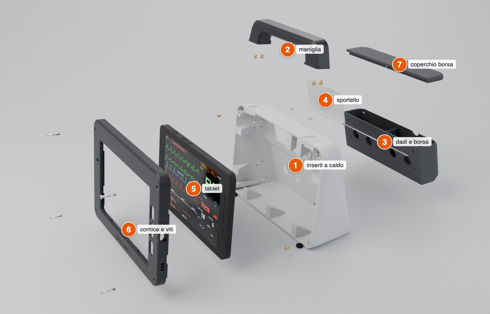
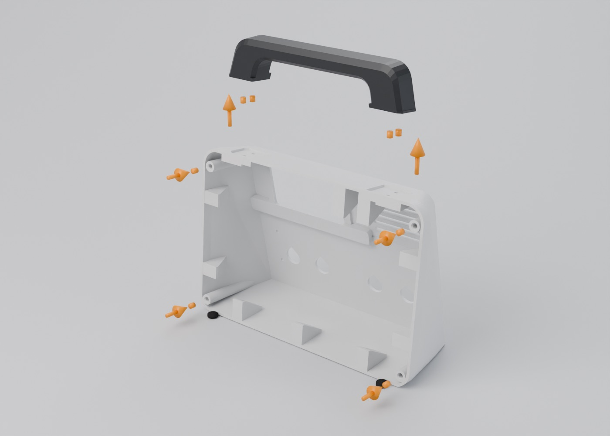
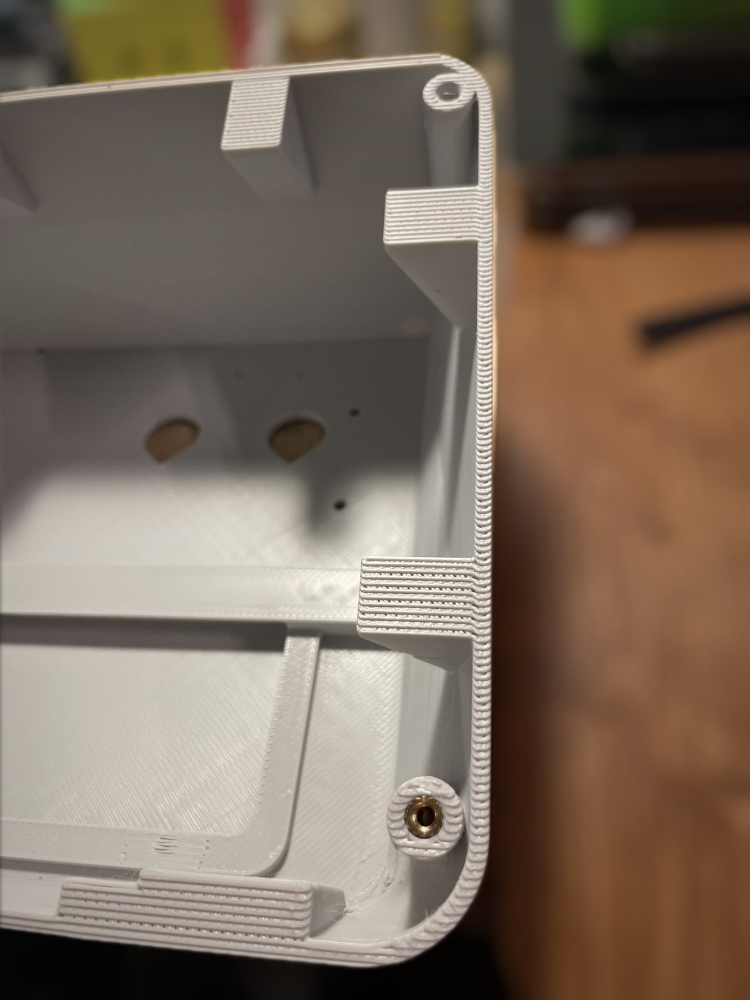
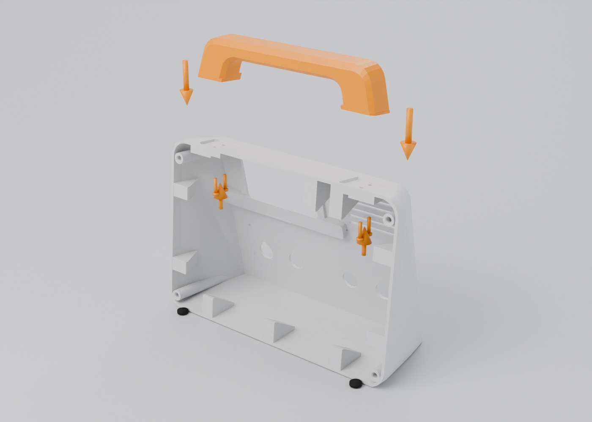
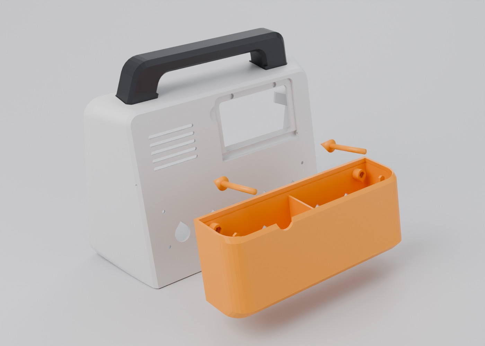
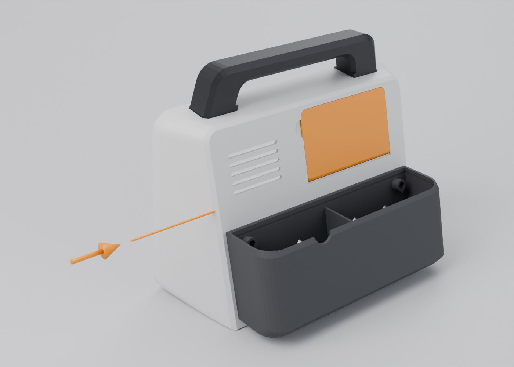
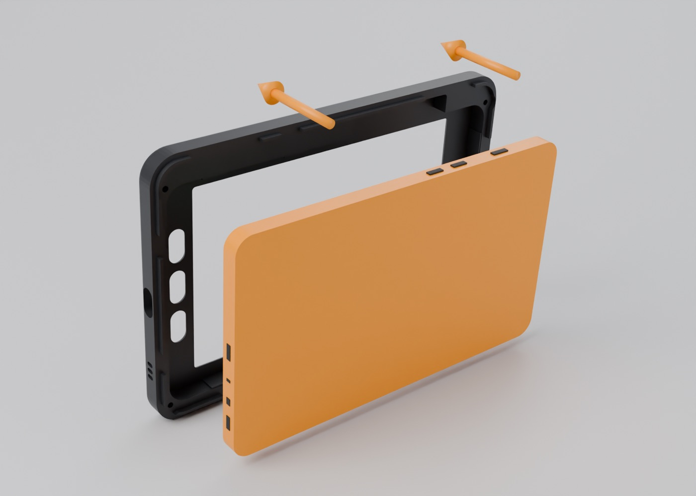
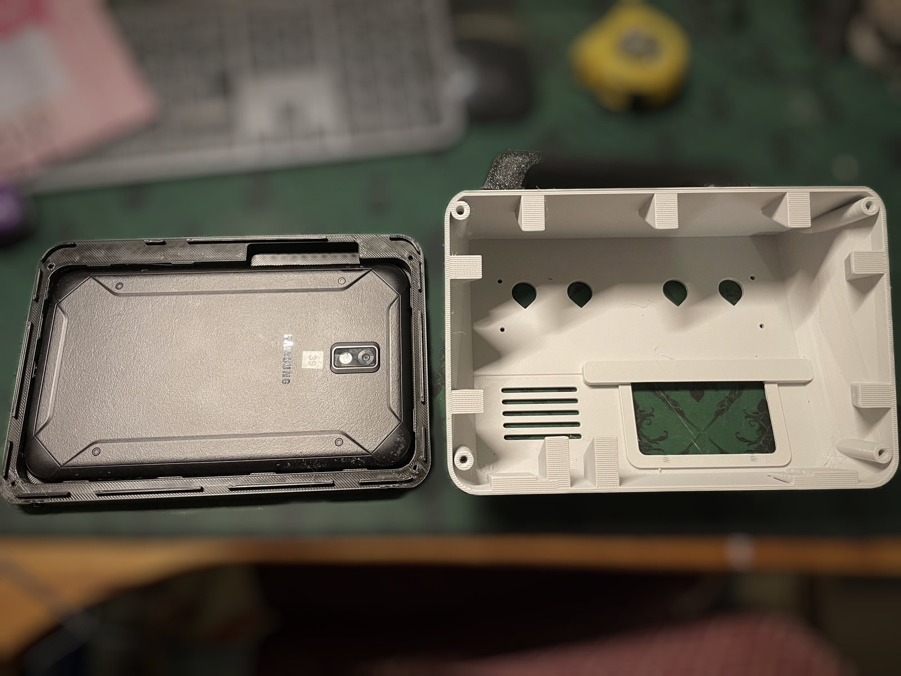
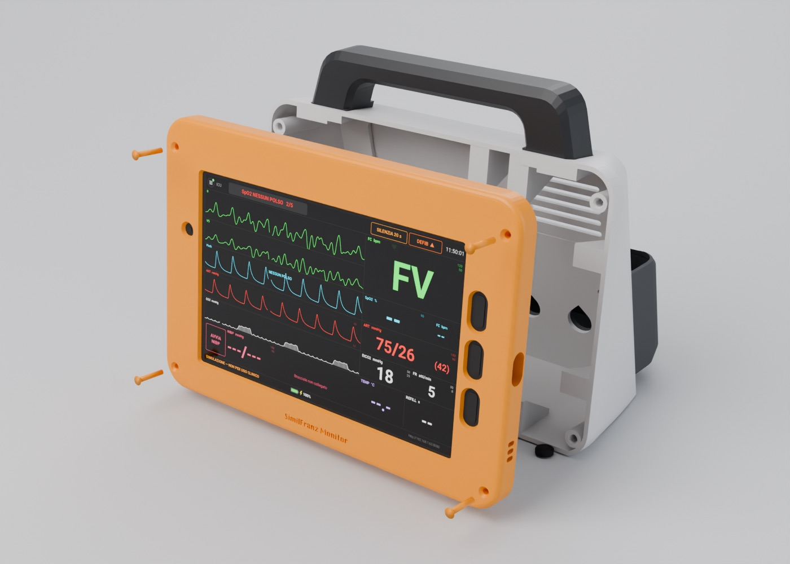
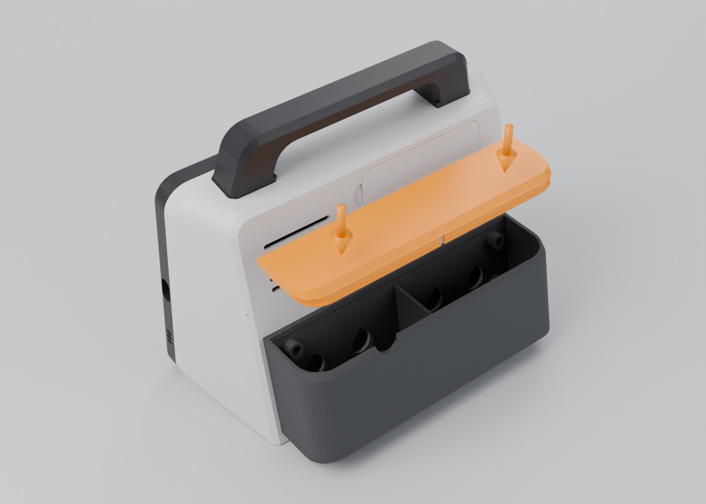

# Montaggio e stampa del guscio (Galaxy® Tab Active2)

**▶ [Guarda il videotutorial di montaggio](https://franz8787.github.io/similfranz-monitor-android/#montaggio)**: i 7 passi in un minuto e mezzo, con la viteria di ogni passo.
Su GitHub il collegamento apre la pagina del file: se il video non parte, scaricalo con «Download raw file».

I numeri nell'esploso sono i passi della sezione [Ordine](#ordine). In tutte le immagini dei passi il pezzo che si
aggiunge è **arancione** e la freccia indica dove va. Le foto dei singoli pezzi sono nella
[tavola dei pezzi](img/pezzi/tavola_pezzi.jpg).

## Materiale
| Cosa | Quanti | Dove |
|---|---|---|
| Vite M3x16 svasata (meglio **M3x18**) | 4 | cornice → inserti della scocca (dal davanti); con M3x16 prendono 3,75 mm dell'inserto, con M3x18 tutti i 5 |
| Vite M3x12 | 4 | maniglia: 2 per gamba, da dentro la scocca verso l'alto, negli inserti delle gambe |
| Vite M3x12 | 4 | borsa posteriore (da dentro la scocca, attraverso il dorso) |
| **Inserto a caldo M3×5×5** | 8 | 4 nelle colonne della scocca (dalla faccia di giunzione), 4 nelle gambe della maniglia (2 per gamba, dal basso) |
| Dado M3 | 4 | solo nelle borchie della borsa TPU (nel TPU l'inserto non tiene) |
| Magnete 5×2 | 4 | 2 nella battuta alta della scocca + 2 nello sportello (colla cianoacrilica, occhio alle polarità) |
| Fil di ferro Ø1 mm | 1 pezzo da ~18 cm | perno della cerniera dello sportello (si taglia a filo) |
| Feltrino adesivo 1 mm | 9 | sulle "dita" della scocca (tengono fermo il tablet) |
| Piedino adesivo Ø10 × 2,5 (paracolpi) | 4 | 2 nelle sedi sotto la cornice (davanti) + 2 sotto la scocca (dietro): il guscio poggia solo su questi |

**Attrezzi**: saldatore con punta per inserti M3 (~220 °C), cacciavite o chiave a brugola a L, pinza tronchese per il
filo, colla cianoacrilica.

## Ordine

Le viti della maniglia e della borsa si avvitano **da dentro la scocca**: per questo maniglia e borsa vanno montate
prima di chiudere il davanti con la cornice.

**1. Inserti a caldo.** Saldatore a ~220 °C con la punta per M3. Metti 4 inserti nelle colonne della scocca, dalla faccia
dove appoggia la cornice, e 4 nelle gambe della maniglia (2 per gamba), dal basso. I fori sono Ø4,3 × 6,5 mm con un
invito: appoggia l'inserto, scaldalo e spingi dritto finché è a filo.

*Sul pezzo stampato: l'inserto, a filo, in una colonna della scocca.*

**2. Maniglia.** Appoggia le gambe negli scassi sul cielo della scocca (entrano di 2 mm), poi avvita 4 viti M3x12 da
dentro la scocca, verso l'alto. Sotto la testa della vite restano circa 10 cm liberi: usa una **chiave a brugola a L**
o un cacciavite corto.

**3. Borsa posteriore.** Infila i 4 dadi M3 nelle borchie della borsa TPU, dall'interno del vano. Appoggia la borsa sul
dorso e avvita 4 viti M3x12 da dentro la scocca, dritte verso il dorso (il cacciavite passa dal davanti, ancora aperto).

**4. Sportello.** Incolla i magneti: 2 nella battuta della scocca e 2 nello sportello, controllando che si attraggano.
Appoggia il rullo dello sportello nella sua sede e infila il fil di ferro dal forellino sullo spigolo posteriore destro:
scorre nel canalino del dorso, attraversa tutto il rullo e si ferma nel foro cieco a sinistra. Taglia l'eccesso a filo
del forellino.

**5. Tablet nella cornice.** Attacca i feltrini sulle 9 dita della scocca. Appoggia la cornice a faccia in giù su un
panno e metti dentro il tablet, schermo verso il basso: le guide lo centrano da sole.

*Sui pezzi stampati: il tablet nella cornice, pronta per la scocca (passo 6).*

**6. Cornice sulla scocca.** Appoggia la scocca sulla cornice (il labbro della cornice entra nella scocca e la centra),
gira tutto e avvita 4 viti M3x18 svasate dal davanti. Attacca i 4 piedini adesivi nelle sedi sotto: 2 nella cornice e
2 nella scocca.

**7. Coperchio della borsa.** Il coperchio in TPU si chiude a scatto: premilo sulla borsa finché il cordolo entra.

## Stampa (piatto da 256 mm, provata su una Bambu Lab A1; STL già orientati)
| Pezzo | Materiale | Ingombro mm | Supporti |
|---|---|---|---|
| cornice **v5** (`tab_cornice_v5.stl`) | PLA | 234 × 158 × 16 | no (a faccia in giù: il labbro resta sopra) |
| scocca | PLA | 234 × 169 × 86 | **sì, solo "dal piatto"**: servono sotto la battuta dello sportello (≈20 cm²) |
| maniglia | PLA | 179 × 37 × 24 | no |
| sportello | PLA | 92 × 58 × 6 | no |
| borsa posteriore | TPU 95A (consigli di stampa nel [guscio iPad](https://github.com/Franz8787/similfranz-monitor/blob/main/stampa3d/STAMPA_TASCHE_TPU.md)) | 190 × 59 × 68 | no |
| coperchio borsa | TPU 95A | 190 × 46 × 10 | no |

Verifiche del set finale (stabilità sulla pedana inclinata, montabilità, controllo delle mesh): [verifiche/VERIFICHE.md](verifiche/VERIFICHE.md).
Sono simulazioni al computer, non una certificazione.

## Modulo aggiuntivo: borsa rigida in PLA (al posto di quella in TPU)
Stessi 4 fori, stesse viti, stesso profilo (v2: inserti a caldo al posto dei dadi): si monta come la TPU, senza toccare
il resto. File: `stl/modulo_borsa_PLA/`.

| Cosa | Quanti | Dove |
|---|---|---|
| Vite M3x12 + inserto a caldo M3×5×5 | 4 | inserti nelle borchie della borsa (dalla faccia che appoggia sul dorso), viti da dentro la scocca |
| Magnete 5×2 | 4 | 2 nelle torrette sul bordo esterno della borsa + 2 sotto il coperchio (colla cianoacrilica, attenzione alle polarità) |
| Fil di ferro Ø1 mm | 1 pezzo da ~19 cm | perno della cerniera |

1. Inserti a caldo nelle 4 borchie (dalla faccia d'appoggio), poi borsa sul dorso con 4 × M3x12 da dentro la scocca.
2. Magneti nelle sedi: borsa e coperchio, controllando che si attraggano.
3. Appoggia il coperchio chiuso: le nocche si incastrano lungo il lato verso il monitor. Infila il filo dal forellino sul fianco **sinistro** della borsa: attraversa tutte e 5 le nocche e si ferma nel foro cieco a destra. Taglialo a filo.
4. Il coperchio si apre verso il monitor fino a ~105° e resta aperto da solo appoggiato allo sportello. Si chiude coi magneti e si solleva dall'invito centrale sul bordo esterno. I cavi delle sonde escono dalle 2 asole sui fianchi anche a coperchio chiuso.

| Pezzo | Materiale | Ingombro mm | Orientamento | Supporti |
|---|---|---|---|---|
| borsa PLA | PLA | 190 × 59 × 72 | in piedi, fondo sul piatto | no |
| coperchio PLA | PLA | 190 × 40 × 7 | capovolto (faccia superiore sul piatto) | no |

## Tempi di stampa indicativi

Ugello 0,6 mm, profilo «0.30 Strength»: cornice circa 2 h 15 min e 120 g, scocca circa 5 h 50 min e 287 g, maniglia
circa 1 h 15 min e 66 g.

---
Modelli 3D © 2026 Francesco Palmisano, licenza CC BY-NC 4.0 ([LICENSE](LICENSE)). Stampa e montaggio (saldatore per gli
inserti a caldo compreso) sono sotto la responsabilità di chi li esegue. Galaxy® è un marchio registrato di Samsung
Electronics Co., Ltd.; Bambu Lab è un marchio dei rispettivi titolari. Progetto indipendente, non affiliato.
