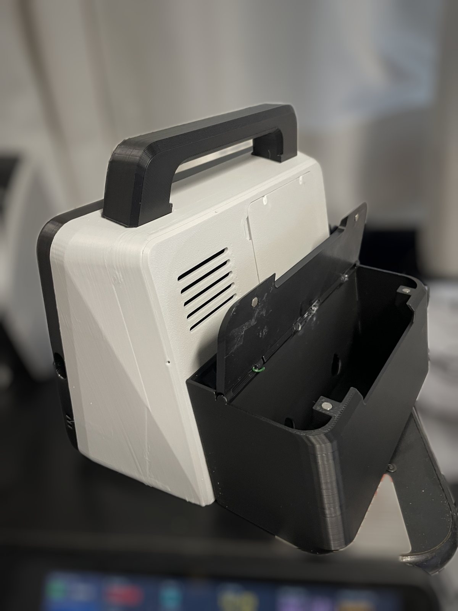
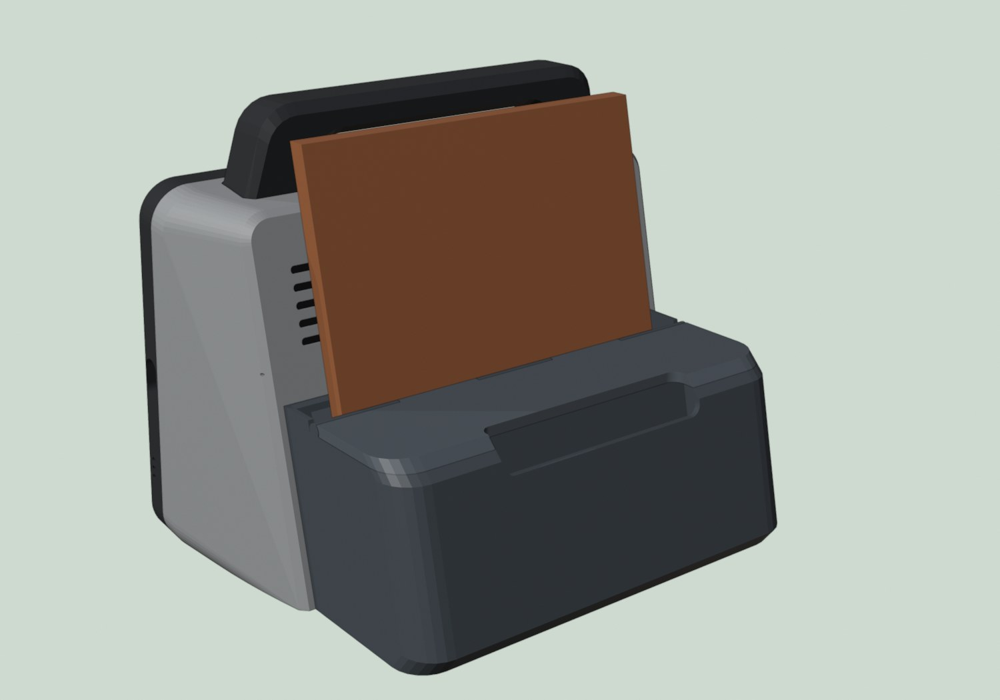
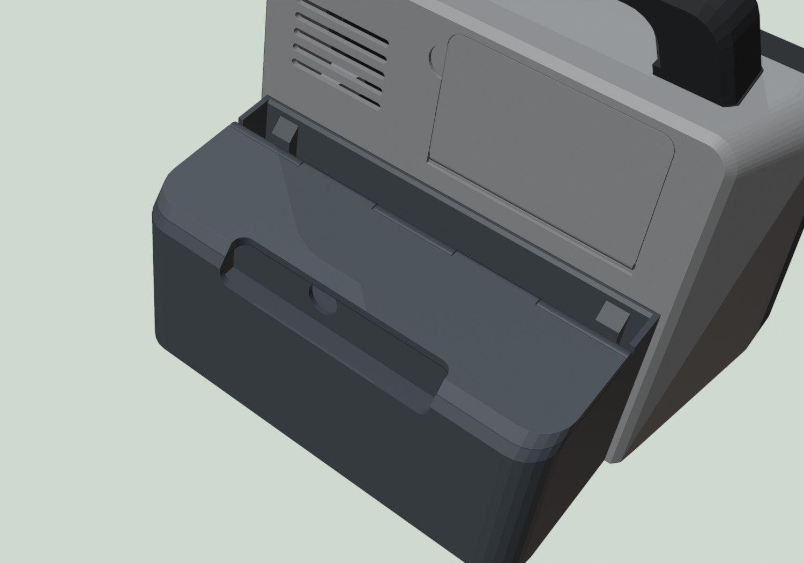
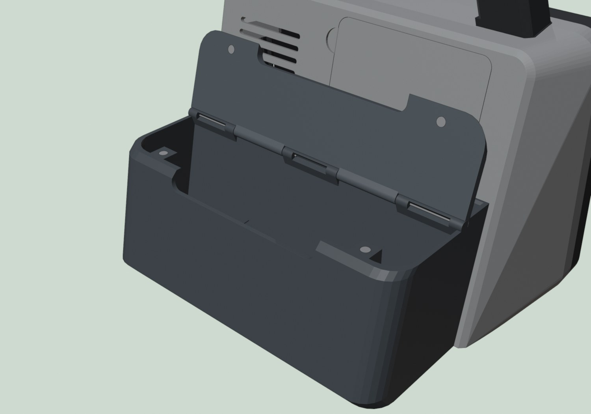
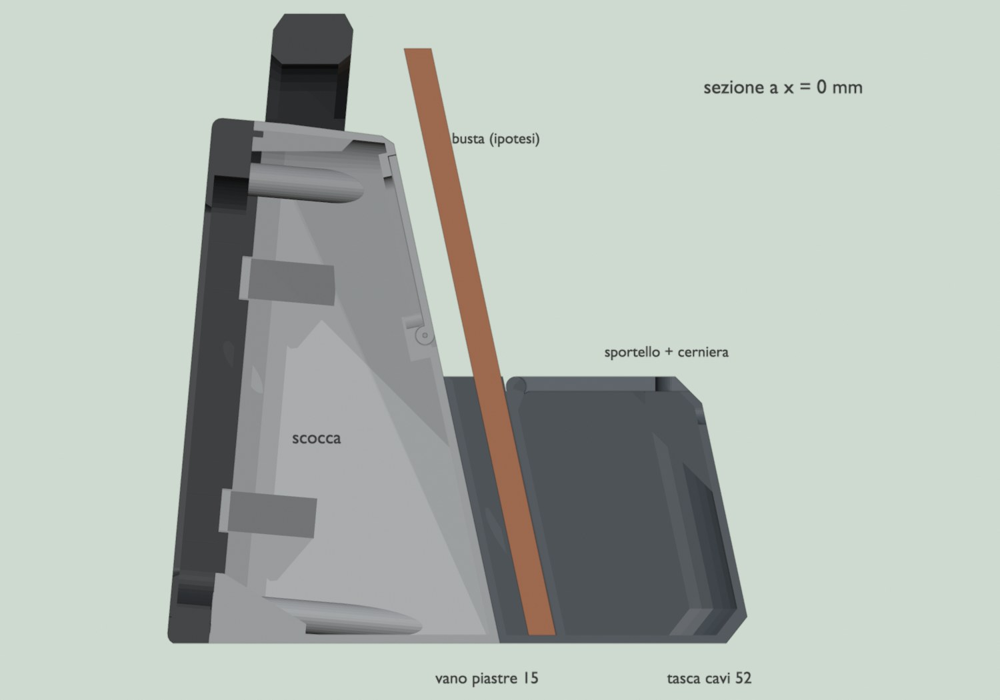
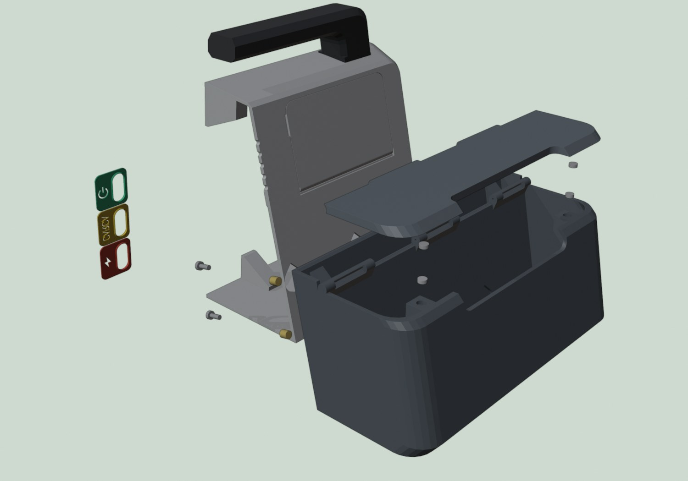

# Tasca posteriore a due vani (prototipo stampato)

> **Prototipo stampato.** Corpo e sportello sono stati stampati in PLA e montati sul guscio, con cerniera e calamite
> (foto sotto). Resta da confermare con l'uso in sessione: tenuta delle calamite nel tempo, busta e cavi dentro.
> Se la stampi, raccontaci com'è andata.

*La tasca stampata, sportello aperto. Il render qui sotto mostra la busta delle piastre nel vano stretto.*

Si monta al posto della borsa posteriore, sugli **stessi 4 fori** del dorso della scocca: la scocca non va modificata.

## Com'è fatta

- **Vano stretto, contro il dorso**: aperto sopra, per la busta delle piastre da addestramento. 15 mm utili di spessore,
  185 mm di larghezza, 79 mm di profondità; il fondo è a filo del lato inferiore della scocca.
- **Tasca dei cavi, esterna**: circa 0,6 litri (52 × 185 × 73 mm), per il cavo ECG e quello del saturimetro. Si chiude
  con uno **sportello a cerniera** tenuto da 2 + 2 calamite Ø 5 × 2 mm; lungo il bordo libero uno scasso lascia uscire i
  cavi a sportello chiuso.
- **Fori per i cavi** (a goccia, Ø 16 mm): i quattro fori del dorso della scocca proseguono nella parete della tasca,
  e due fori bassi nel divisorio, quasi a filo del fondo, portano i cavi da un vano all'altro. Verso l'esterno la tasca
  è chiusa.
- **Asole per fascette** nel fondo del vano delle piastre: quattro coppie, sotto i fori verso la scocca, con una gola
  sotto il fondo che tiene la fascetta incassata. Servono a fermare i cavi a filo del fondo.
- **Cerniera con due pezzi di fil di ferro Ø 1 mm** da 80 mm: si infilano da dentro la tasca, attraverso le fessure delle
  nocche. Fuori non ci sono fori.

| | |
|---|---|
|  |  |
|  |  |

## File e stampa

| pezzo | file | ingombro di stampa | materiale |
|---|---|---|---|
| corpo | [`tab_tasca_corpo_v1.stl`](stl/tab_tasca_corpo_v1.stl) | 190 × 91 × 80 mm | PLA, circa 210 g |
| sportello | [`tab_tasca_sportello_v1.stl`](stl/tab_tasca_sportello_v1.stl) | 190 × 55 × 6 mm | PLA, circa 30 g |

Senza supporti (disattivali del tutto nello slicer): il corpo in piedi, lo sportello capovolto (gli STL sono già
orientati). I soffitti delle fessure del filo salgono a 45° e le torrette delle calamite sono piene fino alla parete:
non ci sono ponti lunghi né parti a sbalzo.

**Minuteria**: 4 inserti a caldo M3 × 5 × 5, 4 viti **M3 × 8** (più lunghe toccano il fondo della sede), 4 calamite
Ø 5 × 2 mm, 2 pezzi di fil di ferro Ø 1 mm da 80 mm.

## Montaggio

1. Inserti a caldo nelle 4 sedi sulla faccia che appoggia al dorso, a filo.
2. Calamite nelle sedi di corpo e sportello, con una goccia di colla; controlla prima il verso, devono attrarsi.
3. Appoggia lo sportello e tienilo aperto. Dalla fessura della nocca centrale infila un pezzo di filo verso sinistra,
   con una leggera piega, fino in fondo; poi il secondo verso destra.
4. Avvita la tasca al dorso da dentro la scocca, con le 4 viti M3 × 8.

## Che cosa è stato verificato, e che cosa no

Al computer, sugli STL: nessuna compenetrazione con guscio e tablet, fori allineati con quelli della scocca, sportello
che si apre fino a 108° e resta aperto, mesh chiuse, stabilità del monitor con la tasca piena (calcolo statico).

Sul pezzo stampato: corpo e sportello montati sul dorso, cerniera col fil di ferro infilata e sportello che si apre
(foto in alto). Ancora da confermare con l'uso: la tenuta delle calamite nel tempo e il comportamento con busta e cavi
dentro. Con la busta infilata lo sportellino dei tasti laterali della scocca resta coperto: per questo il monitor ha
il volume nel menu e l'icona «Blocca schermo» (vedi la [guida al monitor](../../docs/monitor.md#tasti-fisici-del-tablet-e-schermo)).

Le misure della busta sono una stima (160 × 180 × 8 mm): se la tua è più spessa di 10 mm, controlla prima.

---
© 2026 Francesco Palmisano · CC BY-NC 4.0. Solo per la simulazione sanitaria: non è un dispositivo medico.
