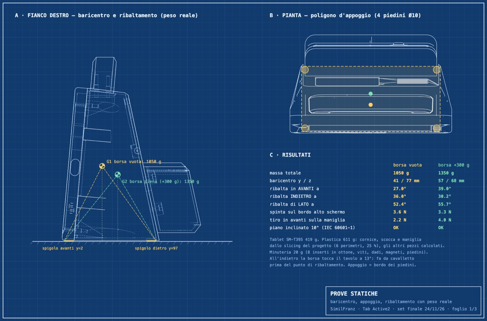
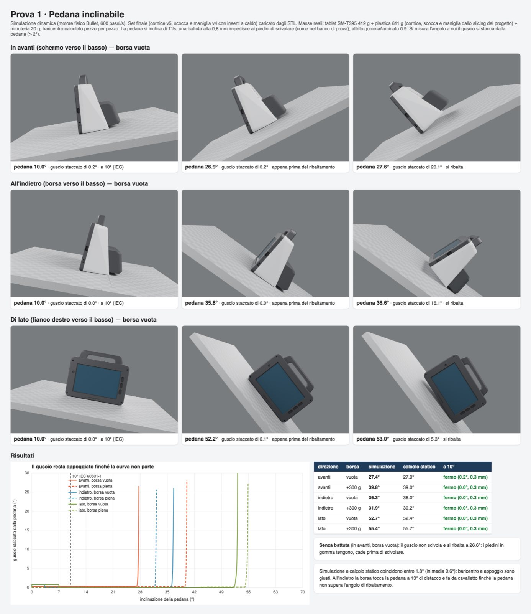
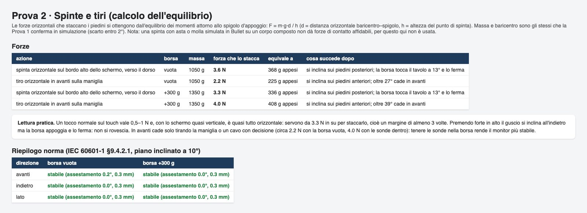
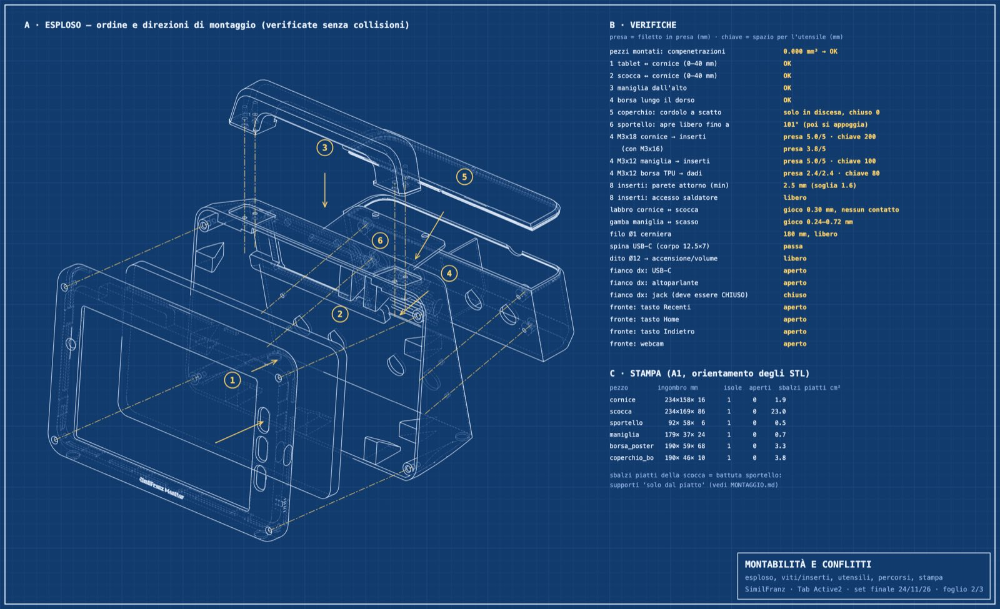
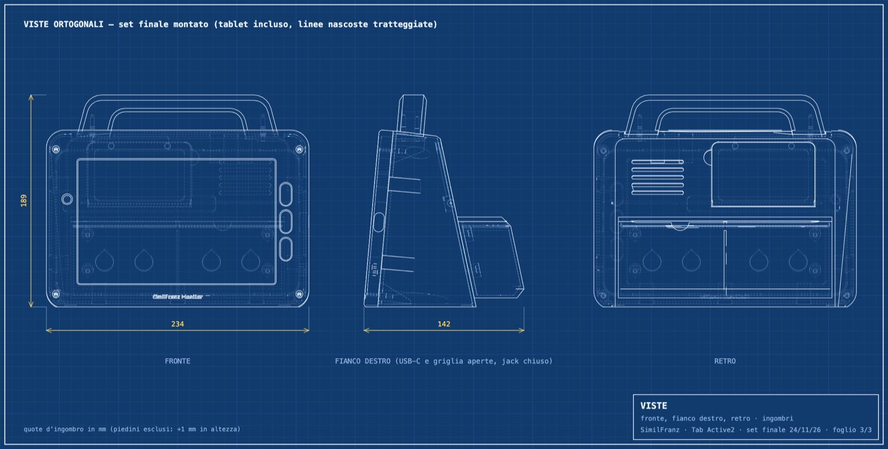

# Verifiche del guscio per Samsung® Galaxy® Tab Active2

Questa pagina raccoglie i controlli fatti sui **file che si stampano davvero** (gli STL nella cartella [`../stl/`](../stl/)),
prima di stamparli. È pensata per formatori, istruttori e facilitatori di simulazione e per chi stampa e monta il guscio.

> **Importante.** Sono **simulazioni e calcoli al computer**, non prove su un pezzo stampato. La prova di stabilità sulla
> pedana inclinata segue il metodo della norma IEC 60601-1 (§9.4.2.1, piano a 10°), ma **non è una certificazione**:
> il guscio è un oggetto per la simulazione sanitaria e non un dispositivo medico. Stampa, montaggio e uso sono sotto la
> responsabilità di chi li esegue.

| pezzo | file | materiale | come si fissa |
|---|---|---|---|
| cornice | `tab_cornice_v5.stl` | PLA | 4 viti M3 svasate dal davanti negli inserti della scocca |
| scocca | `tab_scocca_v4.stl` | PLA | 4 + 4 inserti a caldo M3×5×5 (colonne della cornice, sotto le gambe della maniglia) |
| maniglia | `tab_maniglia_v4.stl` | PLA | incassata nel cielo della scocca, 2 viti M3x12 per gamba negli inserti |
| sportello | `tab_sportello_v3.stl` | PLA | cerniera con fil di ferro Ø1, 2+2 magneti |
| borsa posteriore | `tab_borsa_posteriore_v3.stl` | TPU | 4 viti M3x12 con **dadi** (nel TPU gli inserti non tengono) |
| coperchio borsa | `tab_coperchio_borsa_v3.stl` | TPU | a scatto |
| borsa rigida (facoltativa) | `modulo_borsa_PLA/*_v2.stl` | PLA | 4 viti M3x12 negli inserti a caldo |

**Come sono state fatte.** Ogni pezzo è stato caricato dal suo STL e rimesso nella posizione di montaggio, in Blender.
Prima di tutto ogni STL è stato confrontato con il modello di progetto: lo scostamento è **0,000 mm per tutti gli 8
file**. Poi le misure (fori, inserti, giochi, pareti) sono state prese direttamente sulle superfici degli STL, con
"raggi" virtuali, e non lette dai parametri del disegno. Tutti i numeri di questa pagina vengono dai file
[`risultati.json`](risultati.json) e [`prove_fisiche/`](prove_fisiche/) (calcoli del 24/11/2026).

## In breve

| verifica | esito |
|---|---|
| pezzi montati che si compenetrano | **nessuno** (0,000 mm³ su tutte le 21 coppie) |
| percorsi di montaggio (tablet, scocca, maniglia, borsa) | **liberi** da 0,05 a 40 mm |
| viti della cornice negli inserti | **M3x18: 5,0 mm di filetto in presa su 5** · M3x16: 3,75 mm |
| viti della maniglia negli inserti | **5,0 mm su 5** |
| viti della borsa TPU nei dadi | **2,4 mm su 2,4** (dado intero) |
| plastica attorno agli inserti | **almeno 2,48 mm** (soglia scelta: 1,6 mm) |
| saldatore per gli inserti | **accesso libero e dritto** per tutti gli 8 |
| labbro cornice → scocca | **gioco 0,30 mm, nessun contatto** |
| gamba della maniglia nello scasso | **nessun contatto, entra dritta**; gioco 0,24–0,72 mm (vedi sotto) |
| stabilità (piano a 10°, metodo IEC 60601-1) | **stabile** in tutte le direzioni, borsa vuota e piena |
| controllo delle facce degli 8 STL | **tutti OK** (chiusi, nessuna autointersezione) |

**Da sapere** (niente di bloccante):

1. **Fessura della maniglia.** Il gioco previsto fra gamba e scasso è 0,25–0,39 mm e lo è nel 91 % dei punti misurati.
   Sul fianco interno delle gambe e sul davanti, nell'ultimo millimetro sotto il bordo dello scasso, la fessura si
   allarga fino a 0,72 mm: si vede un po' di più, ma non c'è interferenza.
2. **Peso della borsa in TPU.** Per borsa e coperchio in TPU sono state usate le stesse impostazioni dei pezzi in PLA
   (6 perimetri, riempimento 25 %): la borsa pesa così 122 g. Stampata più leggera, il guscio diventa un po' più stabile
   all'indietro e un po' meno in avanti (a borsa vuota).

---

## 1 · Pesi usati nelle prove

**Tablet**: SM-T395, 419 g (scheda tecnica del produttore).

**Plastica.** Cornice, scocca e maniglia sono state passate allo slicer con le impostazioni del progetto (ugello 0,6,
strato 0,3, 6 perimetri, riempimento 25 % a griglia, supporti ad albero). Dal G-code è stato separato il filamento dei
supporti, che si butta, da quello del pezzo.

| pezzo | filamento totale | di cui supporti | **pezzo finito** | tempo di stampa |
|---|---|---|---|---|
| cornice v5 | 120,0 g | 0,5 g | **119,4 g** | 2 h 13 min |
| scocca v4 | 286,6 g | 23,0 g | **263,4 g** | 5 h 52 min |
| maniglia v4 | 65,5 g | 1,4 g | **63,9 g** | 1 h 14 min |

Gli altri pezzi sono stati calcolati: il pezzo viene riempito di 60 000 punti a caso e si contano come pieni quelli entro
lo spessore delle pareti (6 × 0,62 mm sui fianchi, 3 strati da 0,3 mm sopra e sotto), il resto al 25 %. Sui tre pezzi
dello slicer il metodo dà 111 g, 263 g e 61 g: è vicino.

| pezzo | peso | come |
|---|---|---|
| sportello | 14,3 g | calcolo (PLA) |
| borsa posteriore | 122,2 g | calcolo (TPU, stesse impostazioni del PLA) |
| coperchio borsa | 27,5 g | calcolo (TPU) |
| **plastica totale** | **611 g** | |

**Minuteria: 20 g**, ognuno nella sua posizione: 8 inserti in ottone, 4 viti M3x18 svasate e 8 M3x12, 4 dadi M3,
4 magneti 5×2 e 4 piedini.

**Totale: 1050 g a borsa vuota, 1350 g con 300 g di sonde nella borsa.**

## 2 · Stabilità

**Come.** Il guscio è simulato col motore fisico Bullet (in Blender) a 600 passi al secondo, con le masse e il
baricentro del §1. La pedana si inclina di 1° al secondo, come nella prova della norma IEC 60601-1 §9.4.2.1. Una battuta
alta 0,8 mm ferma i piedini, così si misura il ribaltamento e non lo scivolamento. Attrito gomma su laminato: 0,9.
Dati grezzi in [`prove_fisiche/`](prove_fisiche/) (un file CSV per prova).

| ribalta a… | borsa vuota (1050 g) | borsa piena (1350 g) |
|---|---|---|
| in avanti | **27,4°** (calcolo 27,0°) | 39,8° (39,0°) |
| all'indietro | 36,3° (36,0°) | **31,9°** (30,2°) |
| di lato | 52,7° (52,4°) | 55,4° (55,7°) |
| pedana a 10° (metodo IEC 60601-1) | stabile | stabile |

- **Simulazione e calcolo** coincidono entro 1,8° (in media 0,6°): baricentro e appoggio sono coerenti.
- **Senza battuta** il guscio non scivola: si ribalta a 26,6°, quindi i piedini in gomma tengono.
- **All'indietro** la borsa tocca il tavolo dopo 13° di inclinazione e fa da cavalletto.

**Spinte e tiri** (equilibrio dei momenti con le masse del §1):

| azione | borsa vuota | borsa piena |
|---|---|---|
| spinta orizzontale sul bordo alto dello schermo, verso il dorso | 3,6 N (come 368 g appesi) | 3,3 N (336 g) |
| tiro orizzontale in avanti sulla maniglia | 2,2 N (225 g) | 4,0 N (408 g) |

Un tocco normale sullo schermo vale 0,5–1 N: per staccare il guscio ne serve almeno 3 volte tanto. Anche spingendo forte
in alto, il guscio si inclina all'indietro ma la borsa appoggia e lo ferma.

## 3 · Inserti a caldo

Gli 8 inserti M3×5×5 vanno in fori Ø4,3 profondi 6,5 mm con invito a 45°. Sugli STL sono stati misurati il foro, la
plastica attorno e lo spazio per il saldatore.

| dove | foro misurato | plastica attorno all'inserto (min) | plastica oltre il fondo | saldatore | esito |
|---|---|---|---|---|---|
| 4 colonne della scocca (dalla faccia di giunzione) | Ø4,30 × 6,50 mm | **2,48 mm** | 17,8–33 mm | libero | OK |
| 4 gambe della maniglia (dal basso) | Ø4,30 × 6,6–6,7 mm | **3,27 mm** | 23–26 mm | libero | OK |
| 4 borchie della borsa PLA (facoltativa) | Ø4,30 × 6,50 mm | **2,48 mm** | 3,5 mm | libero | OK |

- **Plastica attorno**: misurata dal diametro esterno dell'inserto (Ø5), in 36 direzioni e a ogni mezzo millimetro di
  profondità. Soglia usata: 1,6 mm. Il valore più basso, 2,48 mm, corrisponde a 4 linee di stampa con ugello 0,6.
- **Fondo**: l'inserto non sfonda nessuna superficie esterna.
- **Saldatore**: un cilindro Ø8 (punta più inserto) lungo 40 mm e uno Ø24 (impugnatura) da 40 a 150 mm, allineati al
  foro, non toccano il pezzo: l'inserto si spinge dritto.

## 4 · Viti, utensili e montaggio

| viti | dove fanno presa | filetto in presa | margine prima del fondo del foro | spazio per l'utensile |
|---|---|---|---|---|
| 4 × **M3x18** svasate, cornice → scocca | inserti delle colonne | **5,0 / 5 mm** | 6,75 mm | 200 mm (cacciavite dal davanti) |
| 4 × M3x16 svasate (in alternativa) | inserti delle colonne | 3,75 / 5 mm | 8,75 mm | — |
| 4 × M3x12, maniglia | inserti delle gambe | **5,0 / 5 mm** | 9,8–11,3 mm | 100 mm sotto la testa (chiave a L o cacciavite corto) |
| 4 × M3x12, borsa TPU | dadi M3 nelle borchie | **2,4 / 2,4 mm** | — | 80–200 mm |
| 4 × M3x12, borsa PLA | inserti delle borchie | **5,0 / 5 mm** | la punta resta nella borchia | — |

- La testa svasata delle viti della cornice resta 0,25 mm sotto il fronte: non sporge.
- **Consiglio**: M3x18 per la cornice. Con le M3x16 lavorano solo 3,75 mm dell'inserto: tengono, ma con meno margine.

**Percorsi di montaggio.** Ogni pezzo è stato fatto scorrere lungo la sua direzione di montaggio (da 0,05 a 40 mm),
sempre senza collisioni: tablet nella cornice, scocca sulla cornice con il labbro che entra, maniglia dall'alto nei suoi
scassi, borsa lungo il dorso.

- **Coperchio TPU**: il cordolo a scatto interferisce solo durante la discesa (è lo scatto); a coperchio chiuso
  l'interferenza è 0.
- **Sportello**: si apre libero fino a **101°**, poi si appoggia al coperchio della borsa.
- **Coperchio della borsa PLA**: si apre libero fino a 105° e poi si appoggia allo sportello.
- **Filo della cerniera**: il filo Ø1 lungo 180 mm passa libero.
- **Labbro della cornice**: alto 3,0 mm, in 1401 punti controllati non tocca mai la scocca (distanza minima 0,30 mm).
- **Maniglia**: 441 punti su 487 (91 %) hanno un gioco laterale fra 0,25 e 0,39 mm; minimo 0,24 mm, quindi mai a
  contatto. Sollevandola da 0,05 a 40 mm non tocca mai la scocca: niente sottosquadri.

**Accessi.** La spina USB-C (corpo 12,5 × 7 mm) passa; griglia dell'altoparlante aperta, jack chiuso; i 3 tasti
frontali e la fotocamera sono scoperti; dallo sportello aperto un dito Ø12 arriva ai tasti laterali.

## 5 · Viste e ingombro

Ingombro del guscio montato: **234 × 142 × 189 mm** (larghezza × profondità × altezza; i piedini aggiungono 1 mm).

## 6 · Stampabilità e controllo delle facce

Gli STL sono già orientati per la stampa e tutti entrano in un piatto da 256 mm.

| pezzo | ingombro mm | sbalzi piatti cm² | note |
|---|---|---|---|
| cornice v5 | 234 × 158 × 16 | 1,9 | a faccia in giù |
| scocca v4 | 234 × 169 × 86 | 23,0 | sul dorso; supporti sotto la battuta dello sportello |
| maniglia v4 | 179 × 37 × 24 | 0,7 | faccia anteriore sul piatto |
| sportello v3 | 92 × 58 × 6 | 0,5 | faccia esterna giù |
| borsa TPU v3 | 190 × 59 × 68 | 3,3 | dritta |
| coperchio TPU v3 | 190 × 46 × 10 | 3,8 | capovolto |
| borsa PLA v2 | 190 × 59 × 72 | 0,9 | in piedi |
| coperchio PLA v2 | 190 × 40 × 7 | 0,4 | capovolto |

**Controllo delle facce** (mesh) di tutti gli 8 STL, rifatto sul set finale:

| file | triangoli | volume cm³ | spigoli aperti / >2 facce | verso incoerente | facce doppie o sovrapposte | autointersezioni | normali verso l'interno | isole | schegge* | esito |
|---|---|---|---|---|---|---|---|---|---|---|
| `tab_cornice_v5.stl` | 11148 | 114,95 | 0 / 0 | 0 | 0 | 0 | 0/800 | 1 | 227 | **OK** |
| `tab_scocca_v4.stl` | 8978 | 231,97 | 0 / 0 | 0 | 0 | 0 | 0/800 | 1 | 171 | **OK** |
| `tab_maniglia_v4.stl` | 2084 | 81,7 | 0 / 0 | 0 | 0 | 0 | 0/800 | 1 | 39 | **OK** |
| `tab_sportello_v3.stl` | 590 | 13,52 | 0 / 0 | 0 | 0 | 0 | 0/590 | 1 | 17 | **OK** |
| `tab_borsa_posteriore_v3.stl` | 3380 | 104,31 | 0 / 0 | 0 | 0 | 0 | 0/800 | 1 | 16 | **OK** |
| `tab_coperchio_borsa_v3.stl` | 810 | 34,45 | 0 / 0 | 0 | 0 | 0 | 0/800 | 1 | 2 | **OK** |
| `tab_borsa_PLA_v2.stl` | 5992 | 113,57 | 0 / 0 | 0 | 0 | 0 | 0/800 | 1 | 47 | **OK** |
| `tab_coperchio_PLA_v2.stl` | 858 | 26,2 | 0 / 0 | 0 | 0 | 0 | 0/800 | 1 | 6 | **OK** |

\* "schegge": triangoli molto stretti (soprattutto nella scritta incisa e attorno ai fori). Lo slicer li gestisce senza
problemi. Tutti gli 8 file sono chiusi, con un solo pezzo per file e volume positivo.

---
Galaxy® e Samsung® sono marchi registrati di Samsung Electronics Co., Ltd. Progetto indipendente, non affiliato.
